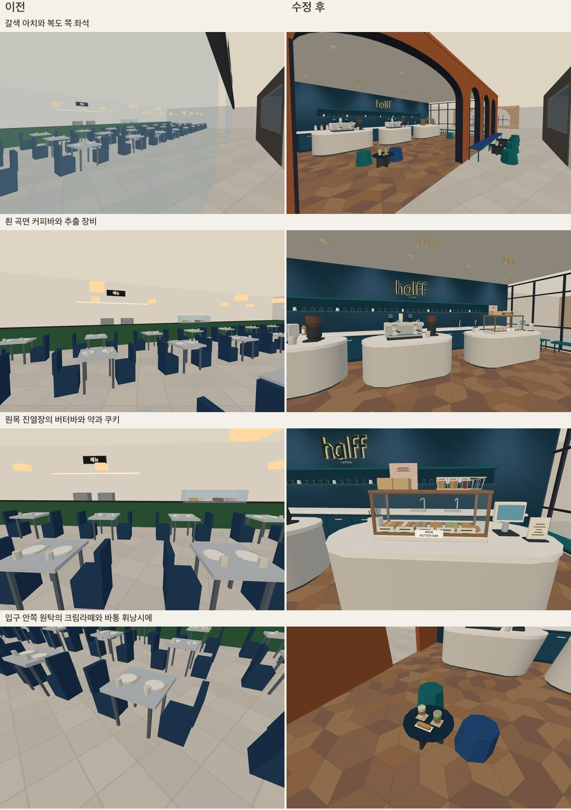

# 하프커피 파미에스테이션 FP212

네이버 지점은 서울 서초구 사평대로 205, 파미에스테이션 2층 FP212호로 안내한다. 신세계 센트럴 도면의 2층 1번 점포다. 지점 사진에는 갈색 아치 너머의 짙은 청색 상호 벽과 흰 곡면 커피바, 매장 안팎의 청록·남색 금속 벤치와 각진 스툴이 보인다. 방문자가 담은 창가 사진에는 격자창을 통해 맞은편 벽돌 회랑의 석재 아치가 보인다. [네이버 지도](https://map.naver.com/p/entry/place/1868037252) · [신세계 매장 목록](https://www.shinsegaecentral.com/famille) · [2층 도면](https://www.shinsegaecentral.com/public/img/famille_floor_2_ko_map.png) · [커피바와 창가 좌석 방문 사진](https://ssdamd.tistory.com/309)

원목 진열대의 버터바, 약과 쿠키, 선물 상자와 철망 바구니는 2023년 방문 사진을 참고했다. 버터크림라떼는 브랜드의 대표 메뉴다. 2026년 9월 지점 방문 영상에도 이 라떼와 바통 휘낭시에가 나온다. 게임에서 두 잔을 함께 놓은 자리와 상품 수량, 아치 간격, 창 밖 회랑의 폭과 높이는 사진의 특징을 게임 점포에 맞춰 구성한 값이다. 현장에서 잰 치수와 현재의 전 상품 재고는 확인하지 못했다. [디저트 진열 사진](https://komdolkun.tistory.com/399) · [하프커피 공식 메뉴 소개](https://www.halffcoffee.com/) · [2026년 지점 방문](https://www.youtube.com/watch?v=g9QiAs269k8)

[Blender 원본](fp212.blend)은 집기, 컵, 쿠키를 포함한 923개 메시를 다섯 컬렉션으로 나눈다. 게임은 같은 원탁 세 곳에 라떼 한 상의 웹 모델을 재사용한다. 청색 벽의 조명은 Blender의 색상 속성으로 구웠다. 창과 공용 출입 아치에서는 안쪽이 보이고, 닫힌 벽과 갈색 기둥이 시야를 가리면 세부 물건을 받지 않는다.

웹 모델은 모두 321,744바이트, 32,658삼각형이다. 같은 일곱 위치를 1000×640 화면에서 각 72프레임씩 측정했다. 수정 전후 프레임 간격 95백분위는 16.7~16.8ms였다. 커피바 앞 전경은 591회에서 592회 그리기로 바뀌었다. 게임 보행 검사에서는 복도에서 매장으로 들어가 주문대에 접근하고, 옆 아치로 다시 광장에 나올 수 있었다. 다른 쪽 복도와 후벽 뒤의 초기 다운로드는 0회, 진열장이 보일 때만 해당 파일을 한 번 받았다.

```sh
blender -b assets/models/halff/fp212.blend --python-exit-code 1 -P assets/models/halff/export.py
node assets/models/halff/check.mjs
```


