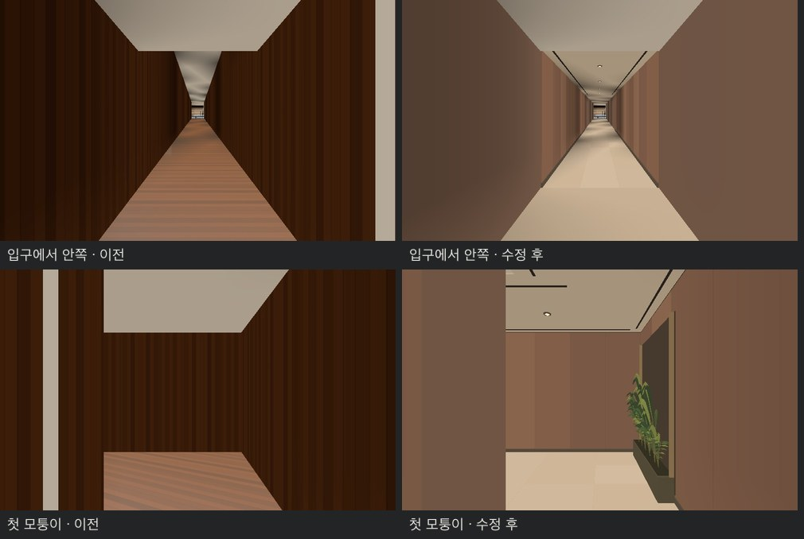

# 하우스 오브 신세계 1층 입구

식당 고량주관이 공개한 방문 영상의 1분 43초부터 1분 57초 사이에 옅은 석재 바닥과 적갈색 벽, 천장 가장자리의 검은 홈, 모퉁이 식재가 보인다. 입구 벽의 패널과 걸레받이, 가느다란 펜던트, 풀잎과 양치 잎을 Blender로 모델링했다. 석판 크기와 금속 색, 식물 종류와 등 간격은 영상을 바탕으로 재구성했다. [고량주관 현장 영상](https://www.youtube.com/watch?v=Jf7mLMraflc&t=103s) · [신세계 강남점 식당 안내](https://deptmapp.shinsegae.com/store/restaurant.do?storeCd=SC00002)

[편집용 Blender 원본](vestibule.blend)에서 입구는 **HouseEntryGallery**, 경사진 바닥과 천장은 **HouseEntryRampBay** 컬렉션에 있다. 경사 패널 여섯 구간은 같은 모델을 공유한다. 입구 GLB는 87,620바이트이고 경사 구간 GLB는 7,712바이트다.

게임 지도에서 **하우스 오브 신세계 입구**를 찾아 들어갈 수 있다. 밤에 가장 어두웠던 방향의 화면 중앙 밝기는 같은 시점과 설정에서 18.5에서 58.1로 올랐다(회색조 0~255). 지상 입구를 왕복하는 동안 두 파일을 한 번씩 불러왔고, 1M 아트 앤 라이프 지도 도착점에서 두 파일의 요청은 없었다.
