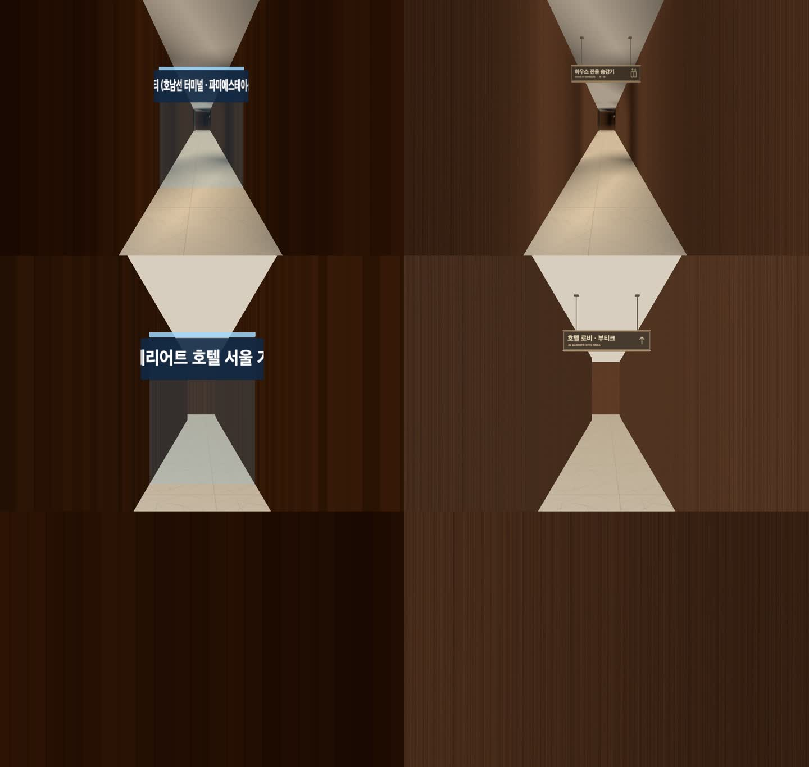

# 하우스 전용 승강기와 호텔 로비

호텔에서 하우스 전용 승강기로 가는 통로에는 호텔 로비의 월넛 마감을 이어 썼다. 기존 벽 11개의 위치와 충돌 폭을 유지했다. 게임에서는 월넛 무늬에 갈색을 한 번 더 곱하던 처리를 없앴다. 통로 양끝에서는 가려졌던 공통 이동 배너를 대신해 진행 방향에 맞는 한글·영문 안내를 읽을 수 있다.

호텔 공식 사진은 월넛 마감의 근거이고, 하우스 공식 개점 사진과 입점 업체 방문 안내는 공개 공간과 전용 승강기의 목적지를 확인하는 근거다. 통로의 목재 치수, 안내판 문구·서체와 매다는 방식은 게임용 재현이다. [호텔 공식 사진](https://www.marriott.com/ko/hotels/seljw-jw-marriott-hotel-seoul/photos/) · [신세계 개점 자료](https://www.shinsegaegroupnewsroom.com/house-of-shinsegae/) · [입점 업체 방문 안내](https://an-clinic.com/sub/AN-CLINIC/Contact-Us)

## 같은 위치에서 본 전후 화면

왼쪽이 수정 전, 오른쪽이 수정 후다. 위부터 밤에 호텔에서 승강기 쪽을 본 화면, 낮에 승강기에서 호텔 쪽을 본 화면, 밤에 통로 벽을 본 화면이다. 야간 화면 중앙의 밝기 중간값(0–255)은 호텔에서 승강기 방향 21.9→45.5, 반대 방향 28.7→52.1, 벽 17.7→39.3이었다. 같은 위치에서 측정한 그리기 호출은 각각 162→158, 569→565, 85→85였다.

- 호텔 쪽 게임 주소는 `#/jwmarriott/1F?p=1.45976,7.26002,101.36675,200.97171,0`이다.
- 하우스 쪽 게임 주소는 `#/centralcity/L?p=4.04759,7.71907,108.06632,20.97171,0`이다.
- 센트럴시티 1층 지도에서 ‘센트럴시티 · 하우스 오브 신세계 연결통로’를 선택하면 같은 평면 좌표의 경사 바닥 높이 1.054m에 선다. 종전에는 아래쪽 높이 0m에 섰다.

`wayfinding.blend`에는 양면 표지 부품 7개와 별도 월넛 벽 컬렉션 11개, 두 무늬 이미지가 들어 있다. 원본은 저장소 루트에서 `blender -b -t 4 -P assets/models/house-lift-passage/build.py`로 다시 만든다. 게임에서는 표지 84삼각형을 한 번에 그린다. 호텔과 하우스 양쪽에서 같은 표지를 사용하며, 다른 층 또는 시야 밖에서 시작한 경우 표지 그리기 모듈과 캔버스를 만들지 않는다.
