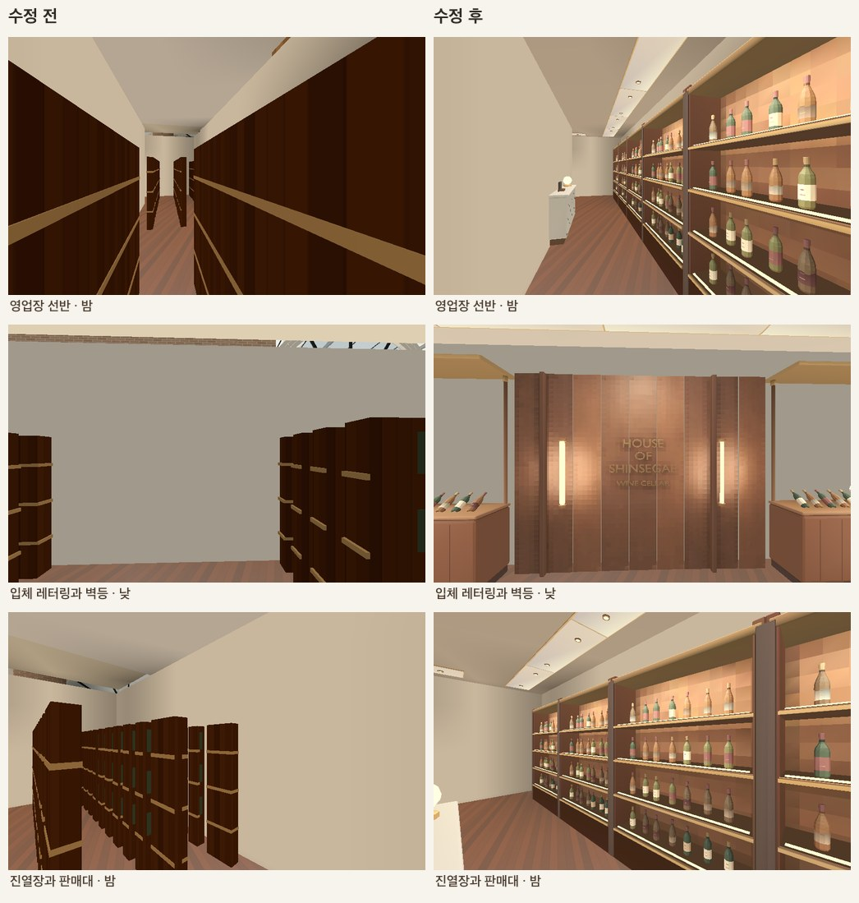

# 하우스 오브 신세계 1층 와인셀라

신세계가 공개한 개점 사진에서 두 개의 긴 벽등과 네 줄 입체 레터링, 황동 진열대와 경사진 병 받침, 석재 카운터와 구형 조명을 확인해 Blender로 만들었다. 매장 외곽과 출입구는 게임의 기존 공개 층별안내 배치를 따랐다. 가구 치수와 간격은 그 배치에 맞춘 추정값이며 병과 라벨은 진열 방식을 보여 주는 예시다. [신세계그룹 뉴스룸의 매장 사진](https://www.shinsegaegroupnewsroom.com/house-of-shinsegae/)

[편집용 Blender 원본](wine-cellar.blend)에는 오크 선반, 입체 문자, 병과 라벨, 금속 부재, 천장과 조명이 들어 있다. 조명을 바꿀 때는 편집한 파일을 저장한 뒤 저장소 루트에서 다음 명령을 실행한다.

```sh
blender --factory-startup -b assets/models/house-wine-cellar/wine-cellar.blend --python-exit-code 1 -P assets/models/house-wine-cellar/export.py
```

Cycles가 매장 조명을 정점 색으로 구운다. glTF Transform과 meshoptimizer가 웹용 모델을 정리한다. 다섯 칸에 쓰이는 선반은 병 28개가 든 모델 한 개를 공유한다. 매장 벽, 사용자 위치, 시선을 확인해 보이는 곳의 상세 파일을 불러온다. 판매대와 선반, 아일랜드 하부에는 보행 충돌 경계가 있다.


