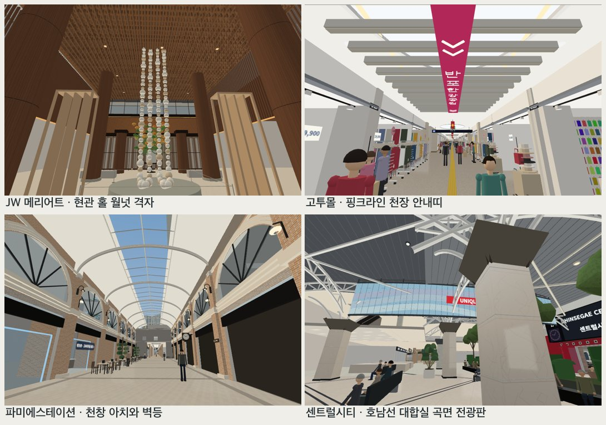

# 상업공간 실내 건축 장식



| 장소 | Blender에서 편집할 컬렉션 | 모델링 근거 |
| --- | --- | --- |
| JW 메리어트 현관 홀 | `hotel-lattice` | 해안건축의 현관 홀 사진에서 어두운 목재 격자가 도자기 조형물 위를 덮는 모습과 격자 하부의 밝은 모서리를 참고했다. 게임에 있던 목재 살을 1.8m 모듈로 교체했다. [설계사 준공 사진](https://www.haeahn.com/en/project/detail.do?prjctSeq=3123) |
| 고투몰 지하상가 | `mall-ceiling` | 서울시가 게재한 사진의 흰 횡살, 버건디색 천장띠, 흰색 두 겹 꺾쇠, 아래쪽의 세로쓰기 ‘반포한강공원’을 구현했다. 설치점은 모델에 이미 있던 안내판 세 곳을 기준으로 했다. [서울시 기사](https://mediahub.seoul.go.kr/archives/2016771) · [안내띠를 올려다본 원본 사진](https://mediahub.seoul.go.kr/uploads/mediahub/2026/01/OsYBVkpKliTApVoRLgGZKzKlGqMXxcNs.jpg) |
| 파미에스테이션 갤러리 | `gallery-rib` | IDBR의 사진을 기준으로 천창을 가로지르는 밝은 아치, 받침 몰딩, 벽에 고정된 굽은 철제 팔과 종 모양 벽등을 모델링했다. 기존 천장 곡면과 아치 간격에 맞춰 배치했다. [설계사 갤러리 사진](https://cdn.imweb.me/thumbnail/20240802/0f0952339cac9.png) |
| 센트럴시티 호남선 대합실 | `terminal-led` | 공개 광고 매체 안내와 기존 대합실 영상 조사에 등장하는 대형 전광판에 패널 사이 이음매와 테두리, 뒤쪽 지지대를 붙였다. 화면의 색면은 게임용 창작 그래픽이다. [센트럴시티 전광판 매체 안내](https://www.allad1.com/centralcity/) · [기존 대합실 조사 기록](../../../data/research/centralcity.json) |

부재 단면, 금속 표면, 반복 간격과 글자 윤곽은 사진 비례에 맞춘 근사치다. 방문객이 서는 바닥과 가구의 물리 형태는 기존 장소 모델에서 가져온다.

## 편집과 재출력

`interiors.blend`의 네 컬렉션은 편집 화면에서 서로 떨어져 있다. 컬렉션 내부의 부재는 각각 편집할 수 있으며 재출력 시 각 컬렉션의 로컬 원점으로 되돌린다. 저장소 루트에서 다음 명령을 실행한다.

```sh
npm ci
blender -b assets/models/interior-architecture/interiors.blend -P assets/models/interior-architecture/export.py
```

`export.py`는 표면과 발광면을 나눠 정점 색상으로 내보낸 뒤 glTF Transform과 meshoptimizer를 적용한다. 네 GLB는 해당 장소의 모듈이 불러온다. `build.py`는 처음 구성한 편집 원본을 되살리는 스크립트다. 실행하면 같은 디렉터리의 Blender 파일을 덮어쓴다.

```sh
node tests/smoke.mjs jwmarriott gotomall famille centralcity
node tests/walk.mjs jwmarriott gotomall famille centralcity
```
