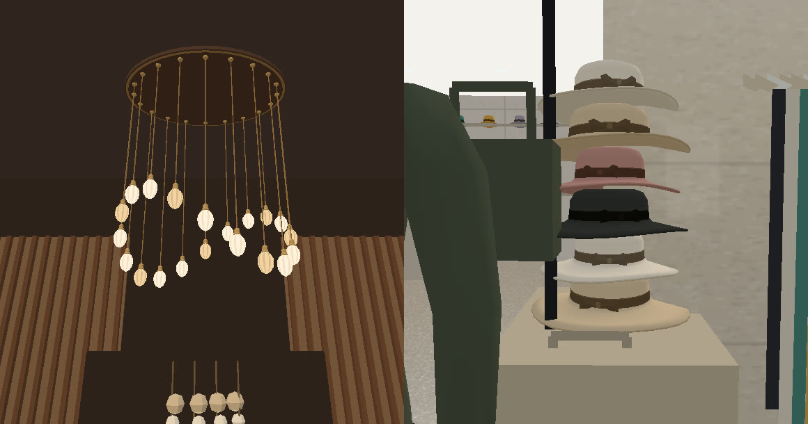

# JW 메리어트 샹들리에와 고투몰 모자



[Blender 원본](interior-finish.blend)의 두 컬렉션을 따로 편집할 수 있다.

| 컬렉션 | 편집할 수 있는 부분 | 게임에서의 사용 |
| --- | --- | --- |
| 현관 샹들리에 · 유리 드롭 | 타원형 천장 받침, 와이어, 황동 소켓, 세로 홈이 난 유리 갓 20개. 유백색과 호박색 유리는 발광 재질을 쓴다. | JW 메리어트 현관 라운지의 기존 샹들리에 자리에 설치된다. |
| 고투몰 진열용 리본 모자 | 살짝 처진 타원형 챙, 둥근 윗부분, 테두리, 접힌 리본과 매듭. | 진열대와 뒤쪽 선반이 같은 메시를 재사용한다. 매장 코드에서 각 모자의 색상·크기·각도를 정한다. |

세부 형상과 재질은 게임용으로 해석했다. 배치는 기존 장소 모델을 따른다. 원본을 저장한 뒤 저장소 루트에서 실행하면 두 GLB에 변경 사항이 반영된다.

```sh
blender -b assets/models/interior-finish/interior-finish.blend --python-exit-code 1 \
  -P assets/models/interior-architecture/export.py
```

공용 내보내기 스크립트는 컬렉션의 `export_model`로 파일 이름을 정하고, `preview_origin` 좌표를 빼서 모델을 게임의 로컬 원점에 맞춘다. `build.py`는 최초 모델을 생성하는 스크립트다.
