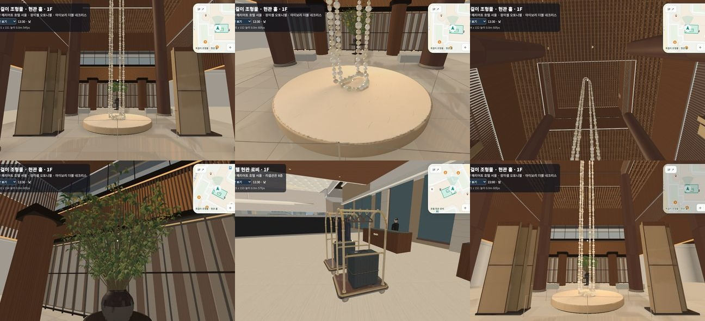
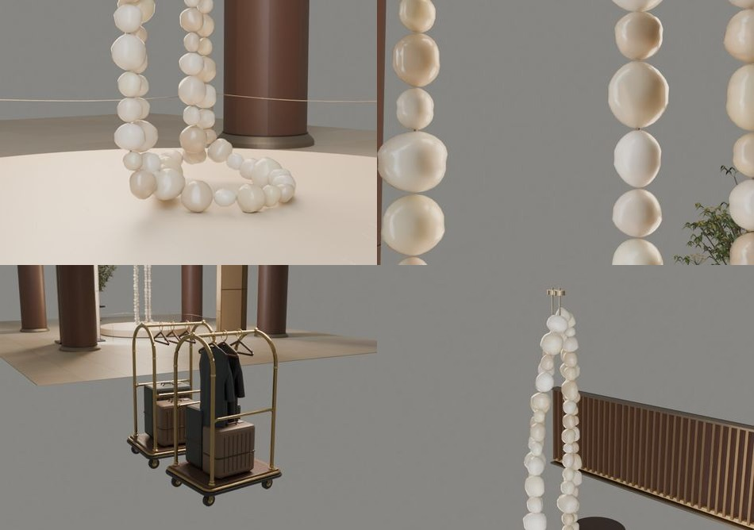

# JW 메리어트 서울 1층 현관



호텔 공식 사진과 2026년 방문 사진은 같은 현관을 서로 다른 시기에 보여 준다. 6월과 8월 방문 사진에는 밝은 원형 단, 가는 보호줄, 월넛 기둥과 금속 병풍이 보인다. 8월 사진 오른쪽에는 벨 카트에 걸린 외투와 가방도 보인다. 진열 색과 받침은 두 방문 사진을 따랐다. [네이버 지도](https://map.naver.com/p/entry/place/11583195) · [6월 촬영 사진](https://m.blog.naver.com/ssunnyp/224463195614) · [8월 게시 사진](https://m.blog.naver.com/l_ovelyoon/224395705177) · [호텔 공식 갤러리](https://www.marriott.com/ko/hotels/seljw-jw-marriott-hotel-seoul/photos/)

장미셸 오토니엘의 *Ivory Double Necklace*를 게임에서 알아볼 수 있도록 무라노 유리알 512개를 두 개의 긴 고리로 만들었다. 유리알 하나씩 빚은 흔적, 불규칙한 목과 움푹 들어간 옆면, 크림색과 호박색 차이를 줄 수 있다. 문헌의 높이 약 15m를 반영해 위쪽 고리가 천장에 닿도록 2·3층에 걸친 중앙 개구부를 복원했다. 개구부의 너비와 주변 연회실 벽선, 유리알 각각의 모양과 배열은 사진 기반 추정이다. [작가 인터뷰](https://www.elle.co.kr/article/1671) · [로비의 개방 층과 구슬 수](https://www.imagazinekorea.com/neighbor/view.asp?SearchGubun=&SearchWord=&no=8489&pType=C&page=2)

[Blender 원본](arrival.blend)에는 21개 컬렉션, 독립 메시 4,518개, 조명 11개, 실제 게임과 대응하는 배치 45개가 있다. 월넛 기둥과 화강암 굽, 연마 바닥, 보호줄, 격자에 붙은 청동 세로살, 바퀴가 회전하는 구조의 벨 카트, 여행 가방의 리브와 이름표, 옷걸이와 외투, 검은 유약 화병과 뒤쪽 꽃 장식을 각각 편집할 수 있다. 원형 단 등 다섯 표면에 Cycles로 구운 빛을 입혔다. 유리알과 바닥의 반사는 게임 현관을 여섯 방향으로 촬영한 환경맵을 쓴다.



호텔의 다른 층이나 승강기 홀에서 시작한 세 번의 검사에서 현관 상세 요청은 0건이었다. 조형물을 등진 곳에서 바닥이 화면에 걸렸을 때는 해당 석판과 반사맵만 받았다. 상단 유리알은 고개를 들어 확인했고, 현관 바닥에서 작품 중심 위 15.44m까지 시야가 열리는지와 인접 연회실 슬래브가 11.2m에 유지되는지를 검사했다. 7.28m를 실제 키 입력으로 걸은 1040×650 Metal Chromium 측정에서 p95·p99 모두 16.8ms, 최장 프레임 66.7ms였다. 네트워크가 차가울 때의 반복 요청도 확인한다.

```sh
blender -b --factory-startup --python-exit-code 1 -P assets/models/jw-arrival/build.py -- --bake --render
node assets/models/jw-arrival/capture-reflection.mjs
node assets/models/jw-arrival/check.mjs
```
