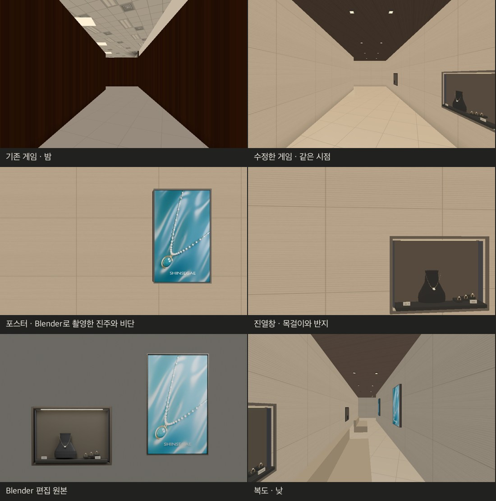

# JW 메리어트와 신세계 강남점의 연결통로

호텔이 안내하는 백화점 연결통로를 일반 보행자 사진과 대조했다. 밝은 가로결 석재, 어두운 목재 천장, 두 줄의 사각 매입등, 세로형 광고 화면과 맞은편 보석 진열창을 반영했다. 진열창과 화면의 크기, 간격은 공개 사진을 바탕으로 재구성했다. 게임 화면에 나오는 진주 목걸이 광고는 이 프로젝트용으로 만든 이미지다. [호텔 오시는 길](https://themargauxgrill.jwmarriottseoul.com/contact-location) · [통로와 진열창 현장 사진](https://jinsungdiary.tistory.com/entry/JW메리어트호텔과-강남신세계백화점-명품브랜드쪽이-연결되네)



게임에서 **M → JW 메리어트 백화점 연결통로 → 여기로 이동**을 누르면 호텔 3층 매장 안내 화면 앞에 선다. 천장은 옆 에스컬레이터가 올라가는 부분을 따라 안으로 들어간다. 두 기존 도착점에서 네 방향씩 본 야간 화면의 중앙 밝기는 18.4~19.6에서 162.4~164.2가 됐다(회색조 0~255). 같은 설정에서 측정한 게임 화면 값이다.

[Blender 원본](finishes.blend)에서 **JewelryShadowbox**는 목걸이·반지와 프레임, **RetailPortrait**는 모니터와 상호, **SquareDownlightPair**는 천장등 한 쌍이다. 모니터의 목걸이와 비단은 [Blender 촬영 스크립트](campaign.py)에서 모델링한 뒤 Cycles로 렌더했다. 근접 화면은 유광 프레임과 광고 이미지를 함께 불러오고 층을 벗어나면 새 진열 GLB를 요청하지 않는다.

```sh
blender -b -t 4 --python-exit-code 1 -P assets/models/jw-retail-gallery/campaign.py
blender -b -t 4 --python-exit-code 1 -P assets/models/jw-retail-gallery/build.py
blender -b assets/models/jw-retail-gallery/finishes.blend --python-exit-code 1 -P assets/models/jw-retail-gallery/export.py
```
