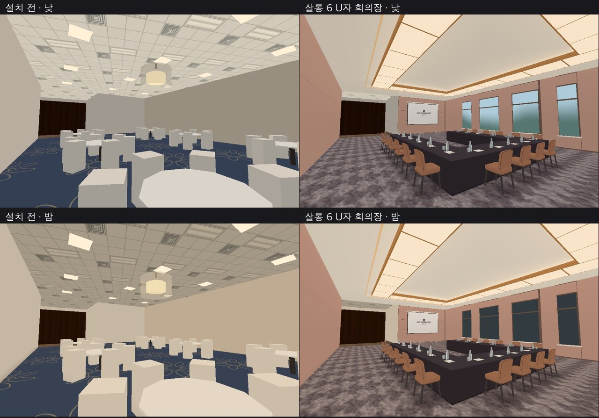

# JW 메리어트 서울 3층 살롱 6

메리어트의 서울 지점 사진 **Salon 6 – U-Shape Meeting**에는 스크린 쪽을 열어 둔 검은 천 테이블, 갈색 등받이와 가는 금속 다리의 의자, 물병·잔·필기구가 보인다. 천장에는 구리색 테두리와 밝은 직사각 패널이 있고, 한쪽 벽에는 높은 창과 수평 창틀이 있다. 게임에서는 살롱 6의 원탁과 원통형 샹들리에를 이 회의 배치로 바꿨다. 같은 갤러리의 **Pre-Function Area**는 다른 공간이다. [메리어트 서울 공식 갤러리](https://www.marriott.com/en-us/hotels/seljw-jw-marriott-hotel-seoul/photos/) · [살롱 6 운영사 사진](https://cache.marriott.com/content/dam/marriott-renditions/SELJW/seljw-meeting-0063-hor-clsc.jpg)

사진은 2026년 11월 27일 확인했다. 가구 간격, 의자 수, 천장 높이는 기존 게임 방에 맞춰 잡았다. 사진에서 구분되는 세리프 글자와 그리핀 실루엣을 스크린에 옮겼다. 창은 기존 옆방 칸막이의 실내 면에 붙였고, 유리의 하늘·녹지 색상은 일반화한 반사 표현이다. 스크린 뒤의 따뜻한 벽판은 기존 벽 폭 안에 두어 뒤편 통로를 비웠다.

게임에서 호텔 3층 지도를 열고 **살롱 6**을 검색하면 U자 테이블 옆을 바라보는 빈 통로에 도착한다. 재현 주소는 `#/jwmarriott/3F?p=-8.1730,11.53,134.2200,166.3282,4`이다. 가까이서 회의 배치가 시야에 들어오면 GLB 한 개(183,656바이트, 7,919삼각형, 한 드로)를 읽는다. 바닥의 직물과 접촉 그림자는 방이 보일 때 한 번 그려 기존 바닥 위에 표시한다. 밤에는 유리 반사가 어두워지고 천장 패널의 전기조명은 유지된다.

## Blender 편집

`salon-six.blend`의 `JWSeoulSalonSixMeeting` 컬렉션에는 세 테이블, 개별 의자와 물병 세트, 스크린, 벽판 및 천장 부품이 있다. 기존 세 테이블의 이름을 유지하고 방의 축을 따라 옮기거나 폭·깊이·높이를 편집하면 내보낼 때 충돌과 거리용 형상도 갱신된다. 원본 생성은 `build.py`, 저장한 원본의 재수출은 다음과 같다.

```sh
blender -b assets/models/jw-salon-six/salon-six.blend -t 4 --python-exit-code 1 --python assets/models/jw-salon-six/export.py
```


