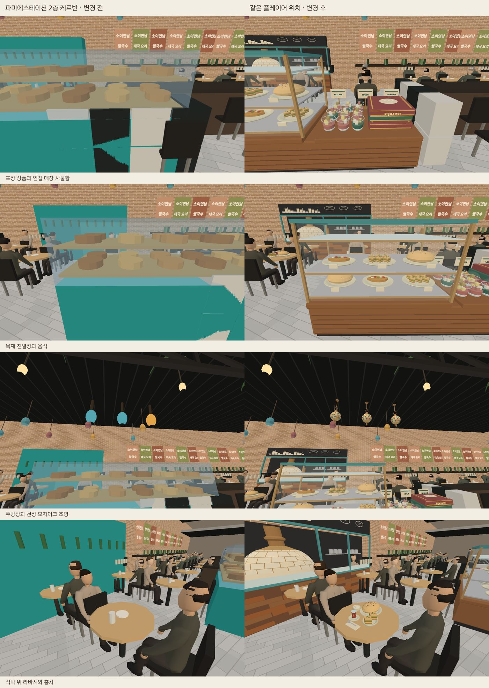

# 파미에스테이션 동관 2층 케르반

서울관광재단은 서초구 사평대로 205 파미에스테이션 2층 216호를 매장 주소로 안내한다. 영문 안내에는 치즈·고기·채소를 올려 구운 피데를 소개한다. [서울관광재단 매장 안내](https://korean.visitseoul.net/restaurants/케르반-파미에스테이션점/KOP029995) · [English Visit Seoul](https://english.visitseoul.net/gangnamarea/KERVANFamilleStation/ENPvds803)

2024년 1월 방문 사진에서 목재·황동 진열장, 유리창 너머의 둥근 화덕, 상자에 쌓인 피슈마니예, 돔 뚜껑을 씌운 로쿰 컵, 마름모꼴 바클라바와 부푼 라바시, 색유리 조명을 확인했다. 프로젝트 보행 기록의 D5 사진 #252–260이 이비티 맞은편 동관 식당가를 해당 매장의 위치로 잡는다. [방문 사진](https://share2learn.tistory.com/224) · [프로젝트 보행 기록](../../../data/research/famille.json)

기존 게임 진열대의 3.50 × 1.05m 범위와 좌석 사이에 맞춰 배치했다. 상자 문양, 메뉴 카드 글자, 화덕의 벽돌 이음과 차림의 조합, 식탁 위 소품 수량과 치수는 사진을 참고한 재구성이다. 옆 소이연남의 사물함이 케르반 포장 상품과 같은 자리를 차지해, 사물함 네 열을 두 매장의 경계를 따라 돌려 놓고 옆 바 끝을 조정했다.

[Blender 원본](fp216.blend)에 내장된 네 묶음에서 진열품·주방창·식탁·조명에 속한 865개 물체를 개별 편집할 수 있다. 게임은 진열장 유리와 불투명 부분을 따로 그리며 가까운 시야에 들어온 파일만 읽는다. 세 등은 한 파일을 공유한다.

```sh
blender -b assets/models/kervan/fp216.blend --python-exit-code 1 -P assets/models/kervan/export.py
node assets/models/kervan/check.mjs
```


