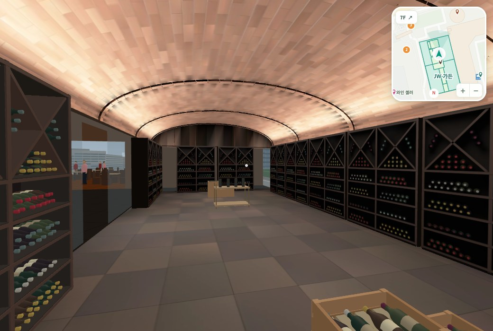

# JW 메리어트 서울 7층 더 마고 그릴 와인 셀러

호텔 공개 사진에서 검은 목재 X자 선반, 병을 눕힌 칸, 나무 상자, 아치형 벽돌 천장과 어두운 석재 바닥을 확인하고 Blender로 모델링했다. 선반 간격과 카트 위치는 게임의 기존 유리 출입구와 보행 폭에 맞췄다. 병 라벨은 직접 그렸으며 실제 상품 목록과 대응시키지 않았다. [호텔 레스토랑 사진](https://themargauxgrill.jwmarriottseoul.com/en/photos) · [호텔 공식 갤러리](https://www.marriott.com/ko/hotels/seljw-jw-marriott-hotel-seoul/photos/)



편집 원본은 [cellar.blend](cellar.blend)다. 선반, 상자, 카트, 천장과 바닥은 별도 컬렉션이고, 선반 안의 병도 개별로 움직일 수 있다. 게임에서는 14개 선반이 한 파일을 공유한다. 먼 선반은 같은 Blender 원본을 정면으로 렌더한 패널을 쓴다. 바닥과 벽돌 천장의 간접광은 Cycles로 굽고 한 장의 1536×1536 텍스처에 담았다.

저장소 루트에서 의존성을 설치한 후 다음 명령을 실행한다. 제작에는 Blender 4.5 LTS와 cwebp를 사용했다.

```sh
blender -b --factory-startup --python-exit-code 1 -P assets/models/margaux-cellar/build.py
node assets/models/margaux-cellar/check.mjs
```

보행 검사는 7층 유리 출입구를 통해 셀러에 들어간 뒤 선반 옆을 10.1m 걷는다. 8층과 뒤쪽 벽 너머에서 셀러 파일 요청이 없는지, 보이는 선반끼리 모델을 공유하는지, 7층 셀러 아래의 5층 연회장이 실제로 5층에 도착했을 때 생성되는지도 확인한다. 거리는 게임 좌표 기준이다.
