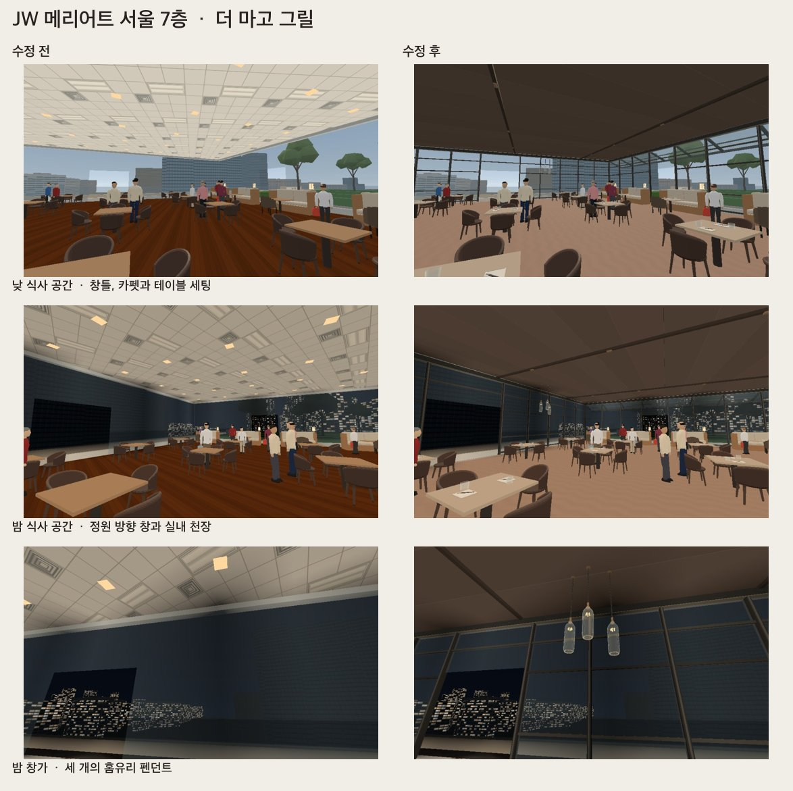

# 더 마고 그릴 · JW 메리어트 호텔 서울 7층

운영사 사진에 보이는 정원 쪽 짙은 창틀과 경사진 유리 처마, 실내의 짙은 천장, 카펫과 밝은 돌 바닥의 경계, 홈이 진 유리 펜던트 세 개를 모델링했다. 테이블에는 사진에서 확인되는 접은 냅킨과 낮은 물잔을 놓았다. 창밖과 정원에는 게임의 낮과 밤이 그대로 보인다. [창가 조명 사진](https://mds-assets.marriott.com/cdn-cgi/image/f=auto/cms-platform-for-marriott/seljw-the-margaux-grill/site-images/migrated-images/interior.jpg) · [정원창 사진](https://mds-assets.marriott.com/cdn-cgi/image/f=auto/cms-platform-for-marriott/seljw-the-margaux-grill/site-images/migrated-images/tmg.jpg) · [호텔 갤러리](https://themargauxgrill.jwmarriottseoul.com/en/photos) · [공간 소개](https://themargauxgrill.jwmarriottseoul.com/en/groups)

게임의 기존 식당과 두 출입구, 위층 바닥을 유지했다. 유리 처마는 실외 쪽으로 돌출되고 실내 천장은 막혀 있다. 창 간격, 조명 위치, 식기 수량과 카펫 무늬는 사진에 맞춘 근사이며 현장 실측값은 없다.

[식사 공간](../../../index.html#/jwmarriott/7F?p=1.26114,30.50000,142.59119,137.70943,6.00000) · [창가 펜던트](../../../index.html#/jwmarriott/7F?p=-4.64388,30.50000,150.21963,-147.21116,21.00000) · [정원 처마](../../../index.html#/jwmarriott/7F?p=-11.97427,30.50000,148.43209,101.17305,29.00000)



일반 보행 카메라의 같은 위치에서 저사양 화면을 비교했다. 화면 중앙 영역의 휘도 중앙값(0–255)은 밤 식사 공간에서 49→60, 밤 입구에서 47→60, 정원창을 바로 본 밤 화면에서 36→36이었다. 낮 식사 공간은 흰 사무실 천장을 짙은 마감으로 바꾸면서 135→80이 됐다. 같은 층에서 등을 돌린 카메라와 8층에는 새 모델 요청이 없었다.

저사양 헤드리스 Chromium에서 같은 길을 W/S로 3분씩 네 차례 왕복했다(수정 전·후·후·전, 총 12분). 총 43,394프레임에서 구간별 p95는 16.7–16.8ms, p99는 16.8ms 이하였다. 기존 서쪽 출입구로 드나들 때 바닥은 7층에 유지됐다.

## 원본과 내보내기

`window.blend`의 네 컬렉션 `GardenSteel`, `GardenGlass`, `GardenFloor`, `GardenLight`를 같은 위치에 배치한다. 카펫 이미지는 원본에 패킹했다. 게임은 근거리에서 한 GLB를 공유하며 재질별로 묶어서 그린다. 실시간 광원 추가는 없다.

```sh
blender -b --factory-startup -P assets/models/margaux-garden-window/build.py
blender -b --factory-startup assets/models/margaux-garden-window/window.blend -P assets/models/margaux-garden-window/export.py
```
