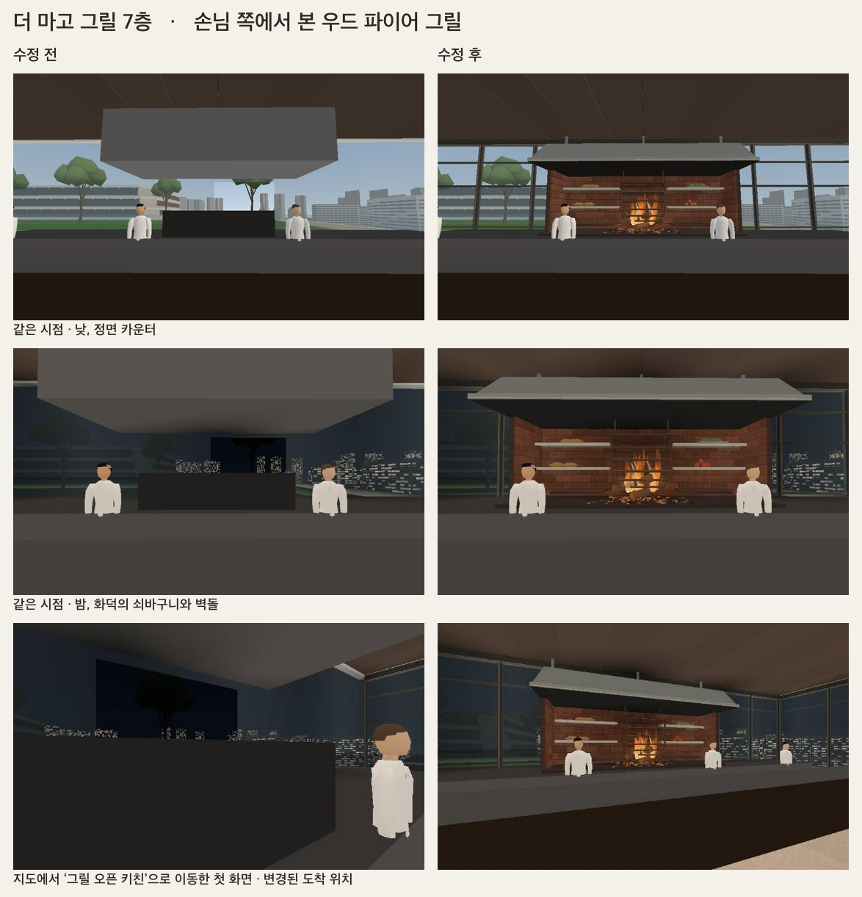

# 더 마고 그릴 · 공개 화덕

JW 메리어트 호텔 서울 7층 더 마고 그릴의 카운터 앞에서 보이는 화덕이다. 호텔 사진에서 둥글게 굽은 쇠바구니, 은빛 선반, 줄눈을 어긋나게 쌓은 벽돌과 재 받침, 장작, 빵과 채소를 확인했다. 게임의 화덕 폭과 후드 높이, 선반 위에 놓인 수량, 프레임 간격은 기존 매장 크기에 맞춘 근사다. [호텔 갤러리](https://themargauxgrill.jwmarriottseoul.com/en/photos) · [화덕 정면 사진](https://mds-assets.marriott.com/cdn-cgi/image/f=auto/cms-platform-for-marriott/seljw-the-margaux-grill/site-images/migrated-images/woodfiregrill.jpg) · [벽돌과 쇠바구니 근접 사진](https://mds-assets.marriott.com/cdn-cgi/image/f=auto/cms-platform-for-marriott/seljw-the-margaux-grill/site-images/migrated-images/the-margaux-grill-woodfire-grill.jpg)

기존 화면에서는 불빛이 짙은 불투명 박스에 완전히 가려졌다. 화덕을 앞에서 볼 수 있도록 박스의 충돌 외곽을 남기고 벽돌과 쇠살을 모델링했다. 식당의 원래 유리벽 양쪽에는 같은 창틀을 이어 문 폭을 유지했다. 지도의 ‘그릴 오픈 키친’을 고르면 손님 통로에서 카운터 건너편이 보인다.

[일반 게임 정면](../../../index.html#/jwmarriott/7F?p=2.52187,30.50000,142.05269,-68.43357,5.00000) · [카운터 앞에서 본 쇠바구니](../../../index.html#/jwmarriott/7F?p=3.75459,30.50000,141.52496,-69.52981,1.00000) · [식당 쪽 사선](../../../index.html#/jwmarriott/7F?p=1.72415,30.50000,139.19883,-99.25284,4.00000)



## 렌더링과 원본

`hearth.blend`에는 `HearthMasonry`, `HearthIron`, `HearthEmbers` 컬렉션 세 개가 있다. 원본에 직접 만든 벽돌 입자 텍스처를 패킹했다. 근접 렌더는 임시 스튜디오 조명을 켜고 저장한 원본을 다시 열어 촬영했다. [Blender 근접 렌더](native.jpg) 게임은 세 묶음을 하나의 388,188바이트 GLB로 요청한다. 창틀은 기존 `margaux-garden-window/window.blend`의 `GardenSteel` 컬렉션에 들어 있다. 재질에 구운 반사광과 화염에만 적용하는 애니메이션을 써서 실시간 조명을 추가하지 않았다.

저사양 일반 보행 화면의 밤 근접 시점에서 숯불 영역의 따뜻한 픽셀 비율은 0%에서 13.7%로 늘었다. 22번 캡처를 비교하면 연속 두 화면에서 평균 RGB 차가 5를 넘는 픽셀은 화염 영역의 5.3%였다. 같은 시간 옆 벽돌과 창문 표본은 모두 0%였다. 같은 층에서 등을 돌리거나 8층에 도착했을 때는 화덕 파일을 요청하지 않았다.

같은 손님 통로에서 W/S로 움직이며 카운터를 보는 3분 구간을 네 번 측정했다(수정 전·후·후·전, 총 12분). 43,435프레임에서 구간별 p95 16.7–16.8ms, p99 16.8ms였다. 기존 JW 구역 563개, 충돌 벽 5,059개, 바닥 지지면 737개가 유지됐다.

```sh
blender -b --factory-startup --python-exit-code 1 -P assets/models/margaux-woodfire/build.py
blender -b --factory-startup --python-exit-code 1 assets/models/margaux-woodfire/hearth.blend -P assets/models/margaux-woodfire/export.py
```
