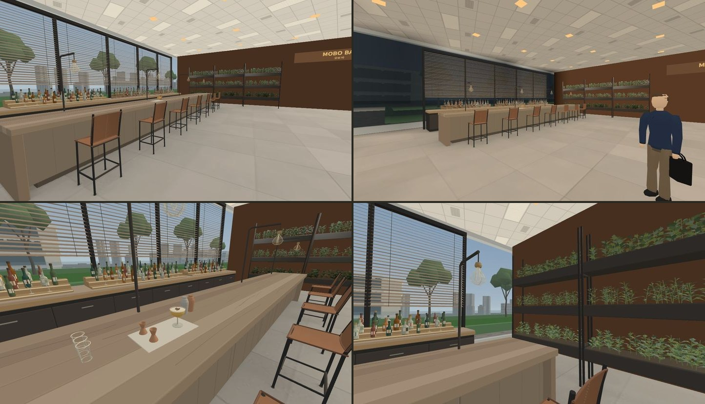

# JW 메리어트 서울 7층 모보 바

정원에서 유리문을 지나면 가죽 하이체어가 놓인 목재 카운터가 보인다. 호텔 사진을 보고 등받이 중앙의 바느질과 검은 금속 발받침, 카운터에 고정한 전구, 블라인드 너머로 빛이 드는 병 진열대, 철제 선반의 허브 화분을 만들었다. 작은 쿠페 잔에는 호텔이 촬영한 칵테일의 옅은 주황색과 거품을 반영했다. [호텔 사진 세 장](https://www.myclubmarriott.com/hotel/restaurantdetail/en/mobo-bar) · [호텔 공식 다이닝](https://www.marriott.com/ko/hotels/seljw-jw-marriott-hotel-seoul/dining/) · [네이버 지도에서 확인한 지점](https://map.naver.com/p/entry/place/1473729000)



게임 지도에서 **모보 바 7F · 정원 쪽 카운터**를 고르거나 7층 정원에서 남쪽 출입구로 걸어 들어갈 수 있다. 카운터 방향과 길이, 의자와 식물 수는 기존 게임 유리벽과 출입구에 맞춘 추정이다. 술병에는 매장 내 재고와 무관한 자체 라벨을 넣었다.

[Blender 원본](mobo.blend)에서 가구, 병, 새들 가죽, 허브, 유리와 금속을 각각 편집할 수 있다. 일곱 의자와 세 개씩 놓인 병 진열·허브 선반은 원본을 공유한다. 먼 병과 허브에는 각 컬렉션을 Cycles로 촬영한 투명 패널을 쓴다. 바닥 타일의 줄눈과 가구의 접촉 그림자는 896×1344 텍스처에 담아 삼각형 두 개로 그린다. 유리 밖으로 보이는 하늘과 바닥에 닿는 빛은 게임 시각에 따라 바뀐다.

Blender 4.5 LTS, cwebp와 저장소의 Node 의존성을 사용한다.

```sh
blender -b --factory-startup --python-exit-code 1 -P assets/models/mobo-bar/build.py
node assets/models/mobo-bar/check.mjs
```

검사는 정원에서 5.5m 걸어 실내에 들어가고, 의자 옆 통로를 따라 10.2m 걷는다. 같은 장면에서 5층 연회장 묶음을 제외한 뒤 최대 렌더 삼각형은 564,214에서 466,222로, 최대 드로콜은 168에서 147로 줄었다. 보행 프레임 간격의 95백분위는 이 기기에서 16.7~16.8ms였다. 8층과 7층 막힌 벽 뒤에서는 모보 바 모델이나 패널 요청이 0건이었다.
