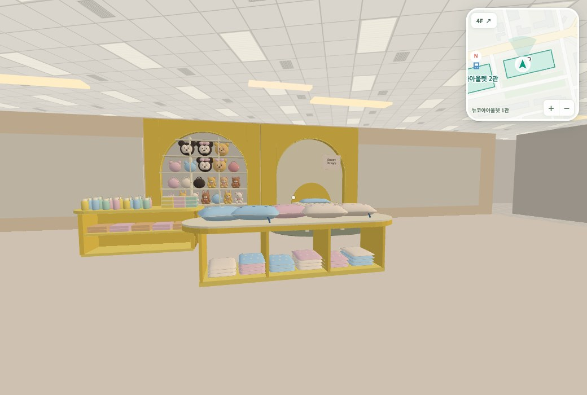

# 모던하우스 강남점 키즈 침구 코너

서울관광재단이 공개한 강남점 매장 사진의 노란 아치형 선반과 반원 머리판 침대, 물병·도시락 진열대, 타원형 베개 매대를 Blender에서 제작했다. 인형 눈과 귀, 파우치 지퍼, 물병 손잡이, 베개 둘레 봉제선과 누비이불의 처진 끝을 개별 메시로 만들었다. 상품 수와 배치는 사진을 바탕으로 가상 매장 치수에 맞췄다. [지점 사진](https://korean.visitseoul.net/gangnam/modernhouse-life/KOPw8jvg2)



[Blender 원본](./kids.blend)에서 세 진열을 따로 편집할 수 있다. 게임에서 침대 쪽으로만 고개를 돌리면 아치와 침대 파일 한 개만 받는다. 세 진열 전체를 볼 때는 세 파일을 각각 한 번 받는다. 뒷벽과 위층에서 다운로드가 발생하는지, 베개 매대와 침대 사이로 3.5m 걸을 수 있는지 검사한다.

```sh
blender -b --factory-startup -t 2 --python-exit-code 1 -P assets/models/modernhouse-kids/build.py
node assets/models/modernhouse-kids/check.mjs
```
