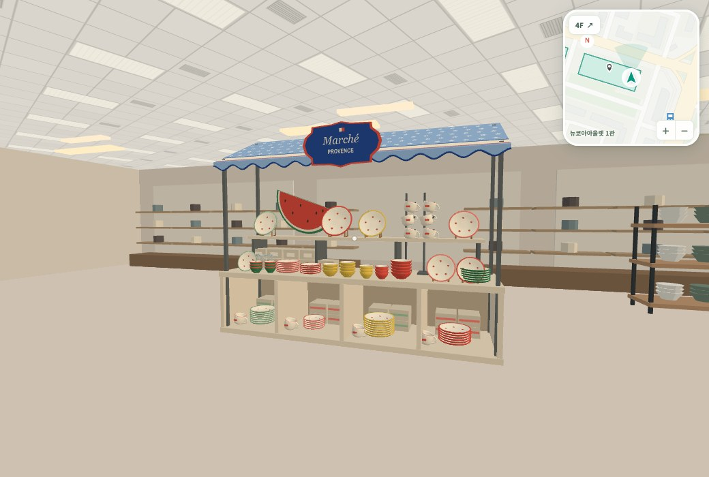

# 뉴코아 강남점 1관 4층 모던하우스

서울관광재단이 2026년 9월 2일 소개한 강남점 주방 코너 사진을 참고해 마르셰 프로방스 진열대를 모델링했다. 푸른 물결 차양과 간판 아래로 수박 접시, 토마토 무늬 접시, 유자색 볼, 머그 걸이와 잔을 배치했다. 사진으로 판독한 상품 구성이며 진열대 치수와 수량은 게임 안에 맞췄다. [지점 사진](https://korean.visitseoul.net/gangnam/modernhouse-life/KOPw8jvg2)



[편집용 Blender 원본](./market.blend)에서 도기 굽·테두리, 포장, 차양과 진열대 부품을 개별 편집할 수 있다. 게임에서는 지오메트리 한 묶음으로 합쳐 그린다. 제자리에서 모델을 등지거나 뒷벽 건너에 서면 상세 파일을 받지 않는다. 매대 양쪽은 걸어서 통과할 수 있다.

```sh
blender -b --factory-startup -t 2 --python-exit-code 1 -P assets/models/modernhouse-provence/build.py
node assets/models/modernhouse-provence/check.mjs
```
