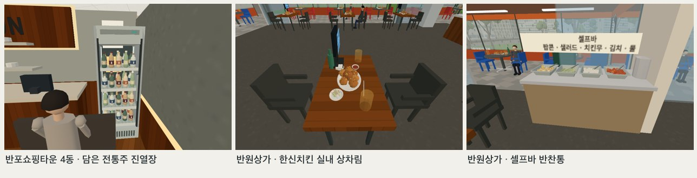

# 반포의 두 식당



반포쇼핑타운 4동 B1 담은의 기존 냉장고 위치에 선반 네 단, 병 몸체와 목, 라벨, 손잡이와 하부 환기구를 모델링했다. 방문자가 촬영한 사진과 매장 기록에서 여러 종류의 전통주를 냉장 진열하는 모습을 확인했다. 개별 병, 라벨 디자인, 수량과 냉장고 치수는 대표 모형이다. [담은 방문 기록](https://polle.com/Galapagos0402/posts/298) · [진열 사진을 포함한 방문기](https://superchart.com/ko/%40anyang-quiet-tray/damdeun-express-bus-terminal-makgeolli-night/)

반원상가 1층 한신치킨에서는 단순한 음식 조각을 후라이드치킨 접시, 양념장, 치킨무, 양배추와 젓가락으로 바꿨다. 매장 안 식탁 여섯 개와 야장 식탁 여섯 개에 같은 모형을 사용한다. 셀프바에는 스테인리스 반찬통 네 개와 집게를 넣었다. 메뉴와 셀프바 구성은 기존 조사와 방문 기록을 참고하고, 그릇과 음식의 크기·담음새는 게임에 맞춰 표현했다. [한신치킨 방문 기록](https://www.diningcode.com/profile.php?rid=0TRk8CcOPOBZ) · [기존 반원상가 조사](../../../data/research/banwon.json)

## Blender 원본에서 재출력

`shops.blend`에는 `damun-cooler`, `hanshin-table`, `hanshin-selfbar` 세 컬렉션이 있다. 각 부재를 편집한 뒤 저장소 루트에서 다음 명령을 실행한다. 내보내기 스크립트는 열린 Blender 파일 옆에 GLB를 저장하고 glTF Transform과 meshoptimizer를 적용한다. `build.py`는 최초 모델을 다시 만드는 스크립트로 같은 이름의 편집 원본을 덮어쓴다.

```sh
npm ci
blender -b assets/models/neighborhood-shops/shops.blend -P assets/models/interior-architecture/export.py
node tests/smoke.mjs banwon banpo_shoppingtown
node tests/walk.mjs banwon banpo_shoppingtown
```
