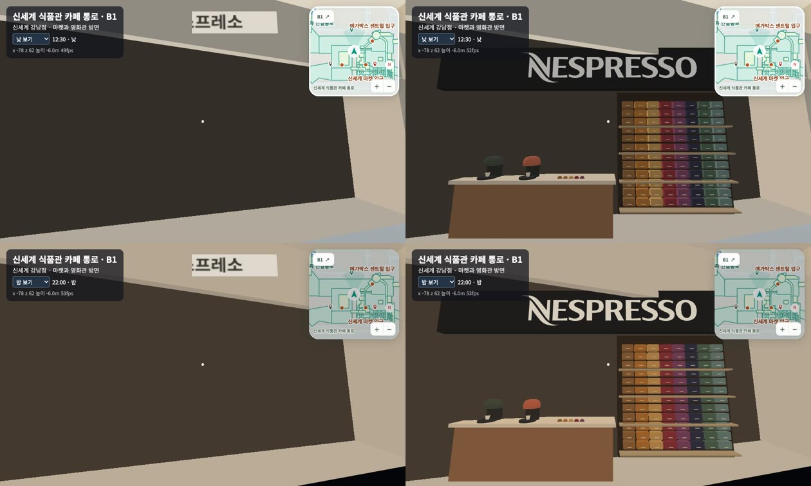

# 네스프레소 신세계 강남점

신세계는 2026년 11월 23–30일 네스프레소 강남점 행사를 백화점 지하 1층으로 공지했다. 네스프레소 코리아의 부티크 시음 안내에도 신세계 강남점이 나온다. [신세계 행사 안내](https://www.shinsegae.com/shopping/list.do?schMainCd=02&schPgIdx=48&storeCd=SC00002) · [네스프레소 시음 안내](https://www.nespresso.com/kr/ko/2024-summer-ice-campaign)

게임의 기존 매장 안쪽에 공식 흰색 워드마크와 버츄오 팝 형태의 둥근 추출 헤드, 잔 받침, 에스프레소 잔, 돔형 캡슐과 색상별 슬리브 진열대를 배치했다. 강남점 현장 사진으로 가구 위치나 색상, 머신 재고를 확인한 것은 아니며 진열 구성과 치수는 게임용이다. [브랜드 원본 로고](https://www.nespresso.com/ecom/medias/sys_master/public/28854691233822/Nespresso-Wordmark-2021-RGB-White.svg) · [버츄오 팝 공식 설명서](https://www.nespresso.com/ecom/medias/sys_master/public/47016327610398/251209-VERTUO-POP-Local-Manual.pdf)

`display.blend`의 `GangnamNespressoDisplay` 컬렉션에서 편집한다. 저장소 루트에서 아래 명령으로 게임용 메시를 다시 내보낼 수 있다.

```sh
blender -b assets/models/nespresso-gangnam/display.blend -P assets/models/nespresso-gangnam/export.py
```

윗줄은 12:30, 아랫줄은 22:00이다. 왼쪽이 기존 매장, 오른쪽이 진열대 추가 후다.


