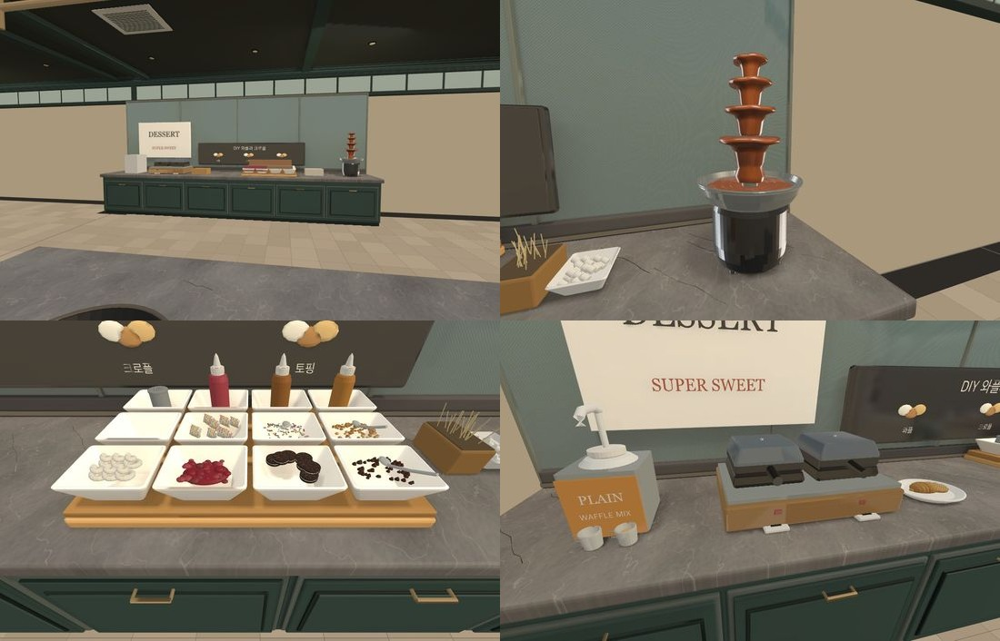
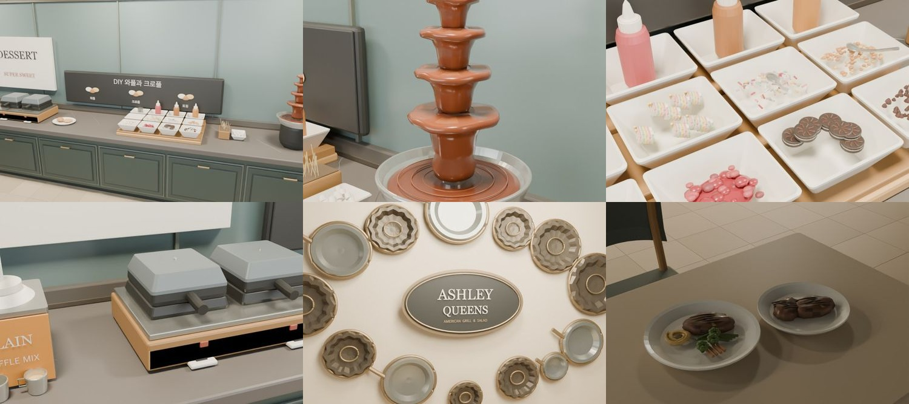

# 뉴코아 강남점 1관 5층 애슐리퀸즈



네이버 지점 사진의 11월 10일 클립에는 검은 원통형 받침, 넓은 스테인리스 볼, 밀크초콜릿이 흐르는 네 단과 옆의 흰 토핑 그릇이 보인다. 11월 22일 실내 사진에서는 녹색 아일랜드의 통풍구, 황동 레일, 검은 천장과 유백색 상부 채광판을 확인했다. 11월 26일 지점 사진의 두 접시를 참고해 구운 스테이크, 브로콜리, 아스파라거스와 파스타도 만들었다. 영업층은 이랜드리테일과 네이버 지점 안내에서 1관 5층으로 확인했다. [네이버 지도 지점](https://map.naver.com/p/entry/place/1920897502) · [지점 사진과 클립](https://pcmap.place.naver.com/restaurant/1920897502/photo) · [이랜드리테일 식당가](https://www.elandretail.com/store05.do?branchID=00110001&lang=000600KO)

와플 기계 두 대의 짧은 손잡이와 경사진 주물 뚜껑, 흰 반죽 펌프, 계량컵과 주방 타이머는 방문 사진을 참조했다. 토핑 그릇에는 코코아 쿠키, 초콜릿칩, 생크림, 딸기 소스, 크럼블, 무지개 스프링클과 줄무늬 마시멜로를 따로 넣었다. 벽에 걸린 구움틀과 타원형 명판은 2025년 입구 사진을 참조했다. 매장 안 가구의 거리, 접시 수, 집기 치수와 신구 사진 사이의 배치 관계는 근사값이다. [와플 기계와 토핑 사진](https://krcaus.tistory.com/m/210) · [입구와 식당 방문 사진](https://veritas-lux-mea-72421.tistory.com/481)

차가운 음식 코너에서는 흰 사각 접시에 담긴 감귤의 흰 속껍질과 과육, 베리를 곁들인 단호박 샐러드, 얇게 썬 피클을 볼 수 있다. 지점 사진을 참고해 접시의 벌어진 테두리와 집게, 메뉴 카드도 만들었다. 게임에서는 온음식 아일랜드 옆에 같은 녹색 하부장을 배치했다. [게임 화면](cold-salad.jpg) · [지점 방문 사진](https://pcmap.place.naver.com/restaurant/1920897502/photo)



[dessert-room.blend](dessert-room.blend)에 편집 가능한 메시 2,110개와 면광원 7개가 있다. 23개의 컬렉션을 게임 30곳에 배치했다. 천장·대리석 카운터 등 7개 컬렉션은 실제 조명이 닿는 분포를 Cycles로 구웠다. 분수의 광택에는 Blender에서 조명 아래 촬영한 초콜릿·스테인리스·에나멜 시료와 게임 매장에서 얻은 반사 지도를 쓴다. 카메라에 들어온 분수만 초콜릿 표면의 흐름을 갱신한다. 전체 상세 GLB는 1,818,792 B이며, 매장에 들어오면 현재 시야와 거리에 따라 개별 집기를 받는다.

아래층, 옆 매장의 벽 뒤, 통로에서 등을 돌린 시점에 새로 접속해 상세 요청이 각각 0건임을 확인했다. 천장을 올려다본 시점에는 천장 메시·조명과 황동 레일만 받았다. 입구에서 분수까지 실제 보행은 9.0 m였고, 분수·와플·토핑·식탁·명판을 돌아본 뒤 재방문했을 때 같은 파일을 다시 받지 않았다. 실내 야간·일출·주간 전환과 두 건물의 에스컬레이터·무빙워크 20개 열도 검사했다.

```sh
blender -b --factory-startup -P assets/models/newcore-dessert/build.py -- --bake --render
blender -b --factory-startup -P assets/models/newcore-dessert/finishes.py
node assets/models/newcore-dessert/capture-reflection.mjs
node assets/models/newcore-dessert/check.mjs
```
