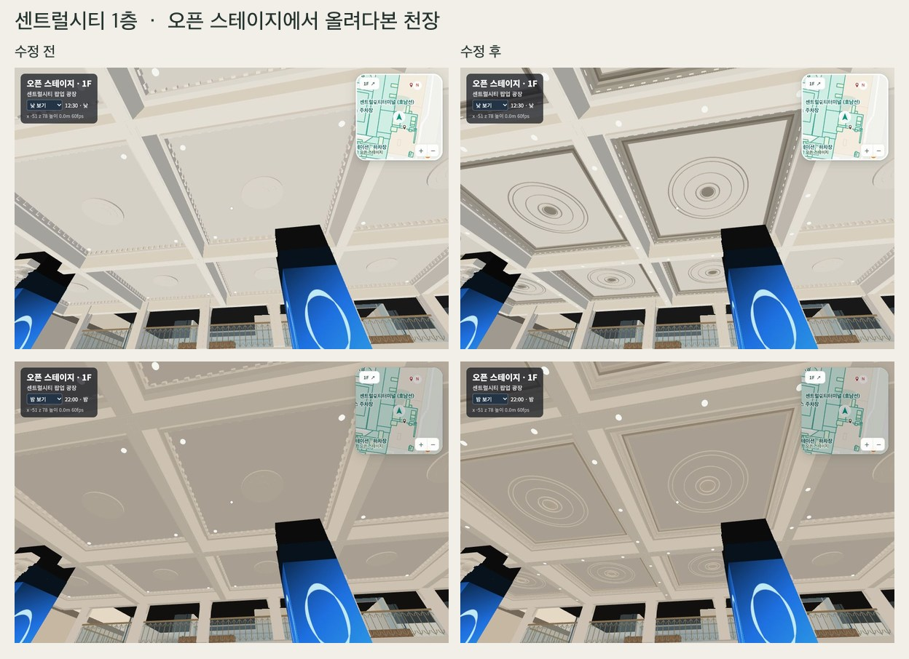

# 센트럴시티 1층 오픈 스테이지 격자 천장

광장 보행 영상 3분 53초와 현장 프레임 검토 기록 CC-D2에 보이는 흰색 격자 천장을 바탕으로 LED 기둥 위 세 줄에 몰딩을 배치했다. 2026년 3월 24일 캘러웨이 행사 사진에서 각 칸 중앙의 낮은 동심원 장식, 안쪽의 사각 턱과 치형 몰딩, 칸 사이 보를 따라 늘어선 작은 매입등을 확인했다. 몰딩의 폭과 깊이, 조명 간격은 게임용 추정이다. [행사 사진](https://image.fnnews.com/resource/media/image/2026/03/24/202603241650545685_l.jpg) · [보행 영상](https://www.youtube.com/watch?v=FeFx7kfWgdo&t=233s) · [현장 프레임 기록](../../../data/research/centralcity.json)

블렌더 원본의 한 칸을 광장 천장 18칸에 반복한다. 기존 천장 보의 하단은 5.65m이며 새 장식의 하단은 6.12m다. 보 밑면의 매입등은 5.645m에 놓인다. [블렌더 원본](coffer.blend) · [게임에서 올려다보기](https://minwoo19930301.github.io/gangnam-terminal-world/?pitch=45#/centralcity/1F?p=-51.211,0.000,78.457,29.962)
