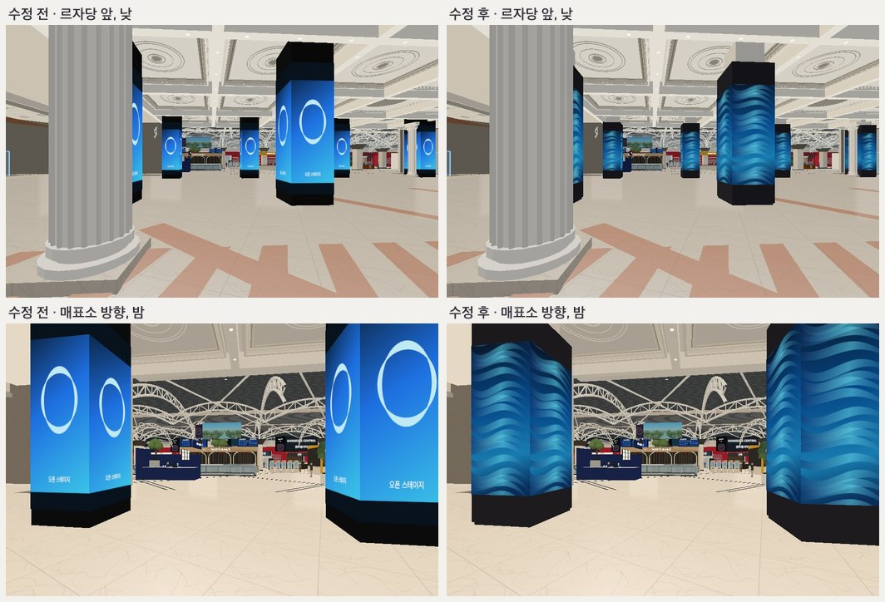

# 르자당 앞 오픈 스테이지와 호남선 매표소

신세계가 2024년 8월 14일 공개한 사진 윗부분에 광장의 네 면 미디어 기둥 여덟 개와 그 너머 매표소가 함께 보인다. 검은 받침과 상단 외장 사이에 세로 화면이 있고, 외장 위로 폭이 좁은 흰 사각 기둥이 천장까지 이어진다. 2026년 3월 24일 행사 사진에서도 같은 구조를 확인했다. 화면 테두리와 받침의 치수는 사진 비례를 따른 게임용 근사치다. 화면의 추상 물결은 전시가 바뀌는 장소를 표현하기 위해 별도로 그렸다. [신세계 설명 및 현장 사진](https://www.shinsegaegroupnewsroom.com/shinsegae-media-art-exhibition-urban/) · [2026년 행사 사진](https://image.fnnews.com/resource/media/image/2026/03/24/202603241650545685_l.jpg)

신세계는 2021년 리뉴얼 때부터 광장을 호남선 매표소 앞으로 소개했다. 게임에서는 르자당 입구에서 광장으로 돌아서면 기둥 사이로 매표소의 풍경 전광판과 창구 표지가 보인다. 대합실에서는 하행 에스컬레이터 끝을 돌아 창구에 접근할 수 있다. [운영사 안내](https://www.shinsegaegroupnewsroom.com/visitor-to-customer-new-world/) · [르자당 지점 안내](https://map.naver.com/p/entry/place/1654024884) · [게임에서 르자당 입구 열기](https://minwoo19930301.github.io/gangnam-terminal-world/#/centralcity/1F?destination=lejardin)

편집 원본의 외장 한 개를 기존 기둥 여덟 곳에 반복 배치한다. 근거리 외장은 인스턴스 한 드로이며 화면은 공통 재질로 그린다. 원본 수정 후 저장하고 기존 공통 스크립트로 내보낼 수 있다. [Blender 원본](cabinet.blend) · [생성 스크립트](build.py) · [내보내기 스크립트](../interior-architecture/export.py)
