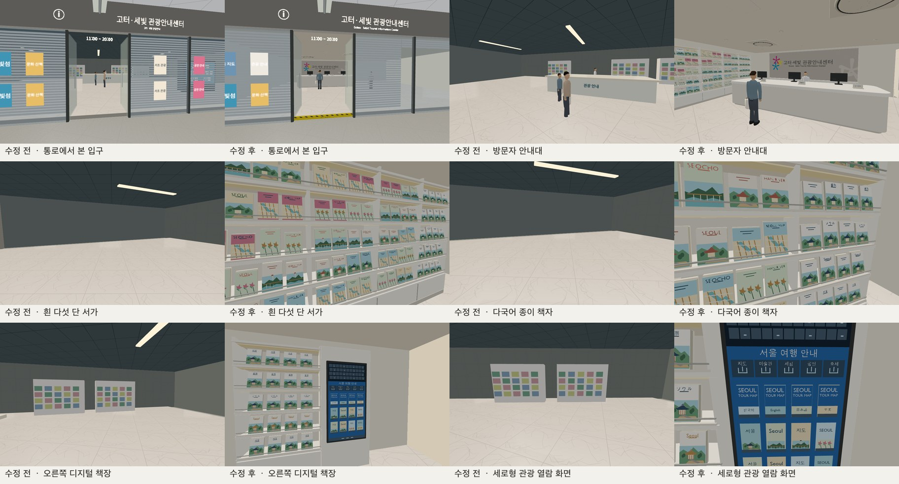

# 고터·세빛 관광안내센터 방문자 공간

네이버 지도와 서울관광재단은 서초구 반포대로 333, 고투몰 G2와 반포한강공원 사이의 지하 공공보행통로에 안내센터를 표시한다. 공식 정면 사진에서 입구의 낮은 노란 문턱, 흰 안내대, 오른쪽 좁은 서가에 이어진 세로 열람기를 확인했다. 실내 사진에는 왼쪽 벽 전체를 채운 다섯 단 서가, 곡면 안내대 뒤의 삼색 심벌과 은색 타공판, 원형 천장 냉방기가 보인다. [네이버 지도](https://map.naver.com/p/entry/place/1229683443) · [서울관광재단 지점 소개](https://korean.visitseoul.net/attractions/2024-Goto%C2%B7SebitTouristInformationCenter/KOPgrw5c5) · [정면 사진](https://korean.visitseoul.net/comm/getImage?srvcId=MEDIA&parentSn=66714&fileTy=MEDIA&fileNo=1) · [실내 사진](https://korean.visitseoul.net/comm/getImage?srvcId=MEDIA&parentSn=66715&fileTy=MEDIA&fileNo=1)

서울시 현장 사진은 한국어, 영어, 일본어, 중국어 서울 안내책자와 관광지 안내물을 보여 준다. 디지털 열람 화면에는 관광지도, 체험, 공연 등 항목과 지도의 표지가 보인다. 모델의 지도 표지에는 한강 다리, 궁궐, 꽃, 산책로를 직접 그려 넣었다. 접힌 책자의 두께와 여분 사본도 개별 메시로 편집할 수 있다. 수량과 진열 순서, 집기의 치수, 블라인드 개방 폭, 현장 화면의 최신 내용은 추정했다. 실제 종이 지도와 열람기 화면 사진을 텍스처로 사용하지 않았다. [현장 기사](https://mediahub.seoul.go.kr/archives/2011692) · [책장 근접 사진](https://mediahub.seoul.go.kr/uploads/mediahub/2024/07/yfdtqbKcsTEBaCRpjCnbACWeIygnPrpz.jpg) · [관광 열람기 사진](https://mediahub.seoul.go.kr/uploads/mediahub/2024/07/HHSrMXKZTtAKdwgdhmZKCHaHgpscZXdK.jpg)

[Blender 원본](visitor-desk.blend)은 매입등과 문턱, 안내대, 긴 서가, 다국어 서가와 열람기, 상호판을 다섯 컬렉션으로 나눈다. 총 2,585개 메시다. 원본 금속판의 5,934개 구멍은 웹에서 반복 무늬를 입힌 두 삼각형으로 표현한다. 상호의 글자와 심벌은 그대로 두고 이 표면을 바꿔, 상호판 한 개를 77,616바이트에서 9,072바이트로 줄였다. 서가와 열람기의 그림과 글씨는 각각 7.8m, 7.0m 안에서 보일 때 상세 모델을 받는다. 다섯 GLB는 총 248,576바이트, 26,871삼각형이다.

게임에서 통로 바닥 −6.00m에서 안내센터 −5.88m로 문턱을 넘고, 안내대 정면과 왼쪽 책장, 오른쪽 열람기 앞까지 걸은 뒤 같은 입구로 다시 나왔다. 멀리서, 등진 상태에서, 닫힌 후벽과 옆벽 너머에서 다운로드는 각각 0회였다. 재방문을 포함해 다섯 파일은 각 1회 내려받았다. 같은 눈높이·위치에서 1000×640 Metal 화면을 8곳에서 각 76프레임 측정했다. 수정 전후 프레임 간격 95백분위는 각 16.7~16.8ms였다. 문 앞 그리기 호출은 102→105회, 책자를 눈앞에서 보는 자리는 194→193회였다. Blender 월드에 배치한 다섯 컬렉션에서 표본 정점과 게임 위치의 최대 차이는 0.093mm였다.

```sh
blender -b assets/models/sebit-information/visitor-desk.blend --python-exit-code 1 -P assets/models/sebit-information/export.py
node assets/models/sebit-information/check.mjs
```


