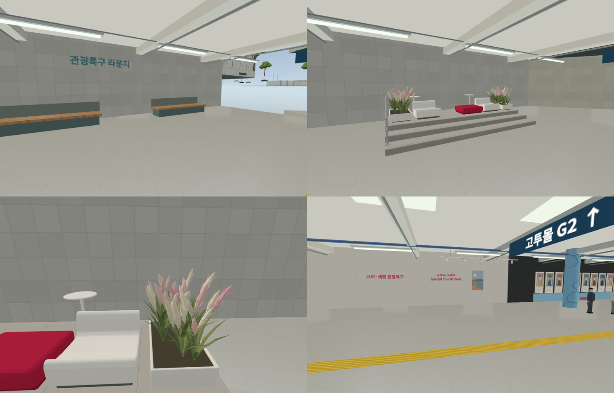

# 고터·세빛 관광특구 라운지



고투몰 G2에서 벽화길을 지나 한강공원으로 가는 B1 라운지다. 좌석 앞 석재 단을 올라 흰 성형 의자, 낮은 붉은 벤치와 원형 탁자를 볼 수 있다. 옆의 화분 두 개는 하나의 메시를 공유한다. 맞은편에는 영문 벽 글씨와 세로 투사면, 원통형 조명 레일이 있다. 공원 쪽으로 폭이 좁아지는 통로의 바닥, 천장과 양 측벽을 세 굴절부에서 연결했다. [게임에서 라운지 보기](https://minwoo19930301.github.io/gangnam-terminal-world/#/onebailey/B1?p=-535.886,-6,-370.505,83)

2026년 1월의 방문 사진을 보고 디딤단, 좌석의 곡면과 붉은 낮은 좌석, 기둥형 탁자, 화분과 꽃이삭, 벽 글씨와 세로 투사면을 모델링했다. 서초구가 라운지의 미디어아트와 무선충전을 안내한다. 충전 패드의 위치는 미확인이다. 단의 높이와 개수, 집기 치수 및 방향, 나들목의 굴절과 폭은 게임 공간에 맞춘 추정이다. 투사면의 한강 풍경은 이 모델을 위해 새로 그렸다. [서울시 시민기자 현장 사진](https://mediahub.seoul.go.kr/archives/2016771) · [서초구 조성 보도자료](https://www.seocho.go.kr/site/seocho/ex/bbs/View.do?bcIdx=406540&cbIdx=61) · [한국관광공사 보행 순서](https://korean.visitkorea.or.kr/detail/rem_detail.do?cotid=26d278ea-4101-44ec-bcfb-46c68a2c146e)

Blender 원본에는 좌석 45개, 화분 683개, 벽면 투사와 조명 35개의 편집 가능한 메시가 있다. 가까이 보이는 컬렉션마다 게임용 메시 하나를 읽는다. GLB 세 개는 합계 232,892바이트다.

```sh
blender -b -P assets/models/sebit-lounge/build.py
blender -b assets/models/sebit-lounge/lounge.blend -P assets/models/sebit-lounge/export.py
node assets/models/sebit-lounge/check.mjs
```

첫 명령은 원본 제작, 둘째 명령은 편집한 원본에서 재출력한다. 검사는 실제 게임에서 좌석 앞 단을 16·32·48cm까지 걸어 오른 뒤 내려오고, 라운지에서 한강공원 나들목 초입까지 왕복한다. 먼 벽화길에서 GLB 요청이 0건이고 화분 두 개가 한 번만 내려오는지도 검사한다. 1000×640 headless Chromium에서 같은 통로 시점의 드로콜은 82회에서 78회, 95백분위 프레임 간격은 16.8ms에서 16.7ms였다.
