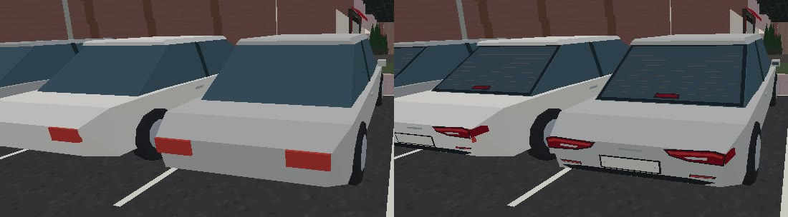

# 신세계 동문 지상 승용차 외장

The two existing rows of parked sedans beside the east drop-off lane use their original fleet chassis, paint, suspension and wheels. Within a 13 m pedestrian view, the additional surfaces show the tail-lamp gasket and tapered lens, lower reflectors, blank registration plates, rear screen frit and heating lines, parked wipers and front projector cups. Lamps on these parked cars are unlit.

The January 2026 Banpo-dong Naver panorama shows a white passenger sedan with rear combination lamps, a pale obscured plate, dark rear glass and a pair of low bumper reflectors. The game interprets these features on its existing generic sedan. The photograph establishes the type of car in the vicinity. Dimensions and lamp outlines follow the game chassis. [Passenger street view](https://map.naver.com/p?p=HK5BFh1JiYwO0LFmRGUw-A,-60,0,80,Float)

The manufacturer’s exterior front/rear photographs and design panel on pages 4–5 give a second reference for the layering of Korean passenger-car headlamp and combination-lamp housings. [Hyundai Avante catalogue](https://www.hyundai.com/content/dam/hyundai/kr/ko/html/pdf/en-cn-catalog/en-catalog/avante-catalog-eng.pdf)

The left image shows the existing fleet at street eye height. The right image uses the same camera after loading the 5,408-byte, 156-triangle detail. Nearby cars share one instanced draw.



## Editing

Open `curb-trim.blend` and edit the meshes in `동문 승용차 · 외장`. The neighbouring fleet library supplies the original car as a linked preview. The tagged body-paint material uses the existing car’s game paint colour. All other face colours are baked into the same primitive. To export the edited native file from the repository root, run

```sh
blender -b assets/models/sedan-curb/curb-trim.blend -t 4 --python-exit-code 1 -P assets/models/interior-architecture/export.py
```

The companion `build.py` reconstructs the original authored collection. A ground-level comparison view is `#/street?p=-36.10482,0.035,-56.06513,126.48216,-12`.
