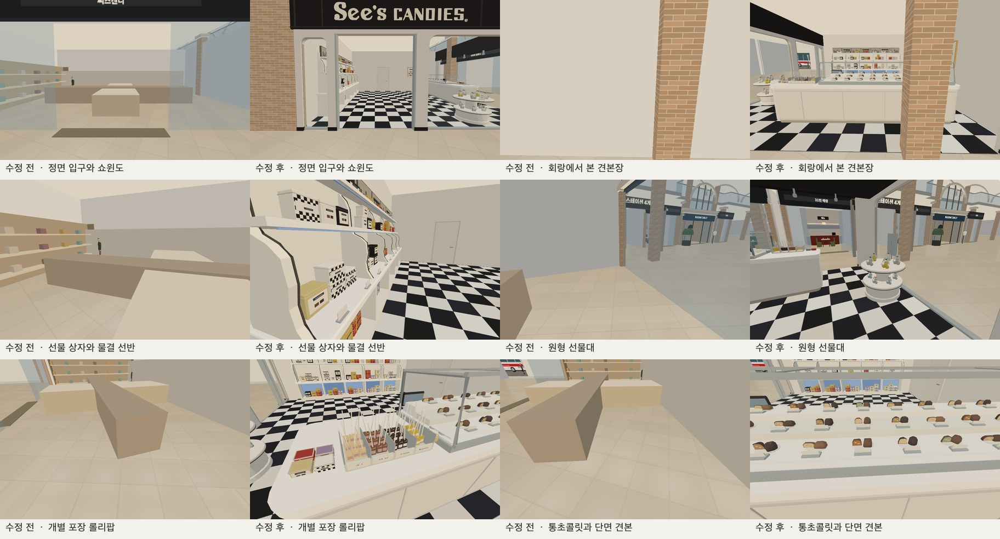

# 씨즈캔디 파미에스테이션 FP-104

씨즈캔디 코리아는 서울 서초구 사평대로 205 파미에스테이션 1층 FP-104를 지점 주소로 안내한다. 신세계 센트럴의 1층 도면에서 20번 점포가 있는 회랑 모서리에 맞췄다. [씨즈캔디 지점 안내](https://www.ksees.co.kr/location) · [네이버 지도](https://map.naver.com/p/entry/place/36444725) · [파미에스테이션 층별 안내](https://www.shinsegaecentral.com/famille) · [1층 평면도](https://www.shinsegaecentral.com/public/img/famille_floor_1_ko_map.png)

지점 사진에서 정면의 둥근 모서리 쇼윈도, 열린 옆면에 놓인 흰 주문대와 기울어진 유리 견본장, 흑백 체크 바닥, 선물 상자 사이의 흰 물결 칸막이를 확인했다. 검은 상호 띠의 입체 글자는 한국 판매사 로고의 윤곽을 따서 만들었다. [지점 리뉴얼 사진](https://seeskr.cafe24.com/bbs/board.php?bo_table=notice&page=2&wr_id=62) · [2025년 7월 지점 방문 사진](https://jidoman.tistory.com/761) · [공식 로고](https://cdn.imweb.me/thumbnail/20261016/ef7ba4900ff9a.png)

견본장에는 통초콜릿과 잘라 놓은 단면을 짝지었다. 캐러멜·크림 층, 견과 조각, 표면의 초콜릿 줄무늬가 서로 다른 8가지 모양이다. 롤리팝은 사진처럼 흰 막대가 위를 향하며 네 칸에 나뉜다. 원형 탁자에는 리본이 달린 선물 봉투가 놓였다. 판매 중인 전 품목이나 재고 수량은 확인되지 않았다. 모델의 견본 27쌍, 매장 폭 7.88m와 깊이 7.22m, 진열대와 후벽의 위치, 유리 기울기는 당시 사진과 게임 도면에 맞춘 추정치다. [진열장과 초콜릿 단면 사진](https://jidoman.tistory.com/761) · [롤리팝 네 가지와 주문대](https://yooji22.tistory.com/5)

[Blender 원본](fp104.blend)에는 외벽과 상품, 유리를 여덟 컬렉션으로 나눈 1,791개 메시가 있다. 가까운 물건에만 상세 모델을 쓴다. 흰 주문대 앞 견본은 5.65m, 롤리팝은 4.6m 안에서 해당 진열을 볼 때 파일을 받는다. 두 유리 모델은 원본에서 내보낸 작은 정점 배열을 그대로 사용한다. 여섯 GLB는 470,240바이트, 45,723삼각형이다.

실제 플레이어로 출입구를 통과해 흑백 타일을 밟고 옆 회랑까지 걸었다. 두 곳 모두 게임 바닥 높이는 0m였다. 정면 유리와 견본장 앞에서 실제 충돌을 확인했다. 멀리서, 등졌을 때, 막힌 두 벽 너머에서는 새 다운로드가 0회였고, 접근과 재방문 중 각 파일은 한 번씩 내려받았다. 불투명한 후벽 뒤에선 상세 진열 다섯 개가 모두 숨겨졌다. 아홉 위치에서 각각 72프레임씩 캡처했다. 1000×640 Metal 환경에서 수정 전후 95백분위 프레임 간격은 16.7~16.8ms였고, 정면 입구의 그리기 호출은 569회에서 573회로 늘었다. Blender 월드에 배치한 여덟 컬렉션의 표본 정점은 게임에서 추출한 위치와 최대 0.032mm 차이가 났다.

```sh
blender -b assets/models/sees/fp104.blend --python-exit-code 1 -P assets/models/sees/export.py
node assets/models/sees/check.mjs
```


