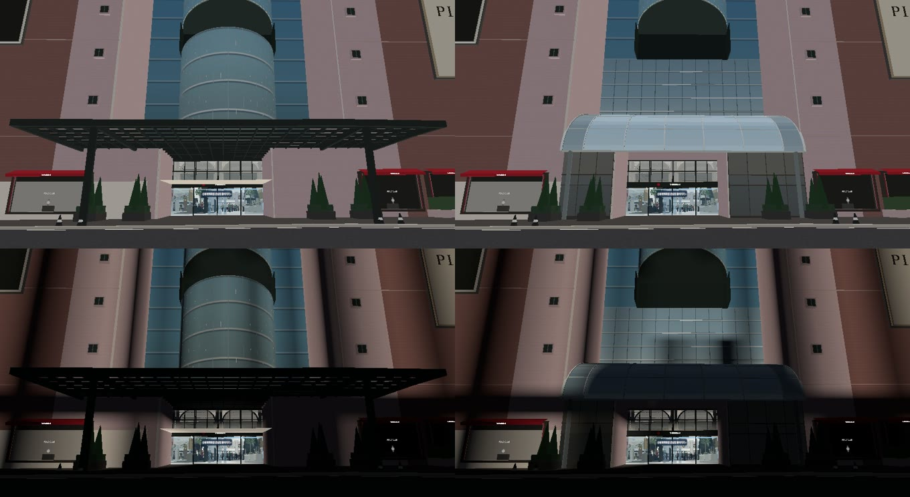

# 신세계 강남점 신반포로 정문

2026년 1월 네이버 거리뷰와 11월 5일 공개된 신세계백화점 제공 사진에서 정문 후드는 앞으로 둥글게 꺾인다. 양끝은 짙은 유리이고 중앙에는 은회색 패널과 가는 이음선이 보인다. 아래에는 어두운 고정 유리창이, 위에는 수평 프레임을 단 평유리벽이 이어진다. 가장 위쪽에만 원통형 베이가 돌출된다. 외장과 기둥 치수, 반사 밝기는 사진 비례에 맞춘 근삿값이다. [2026년 1월 네이버 거리뷰](https://map.naver.com/p?p=lHsXW6lxT97x-yAj0PFdXA,180,0,80,Float) · [신세계백화점 제공 정문 사진](https://tnnews.co.kr/archives/298378)

공식 1층 안내도에서 왼쪽의 1 GATE가 신반포로 정문이다. 게임 지도에서 ‘신세계 강남점 정문 (신반포로)’을 선택하면 출입문을 향해 선다. 헤드리스 Chromium에서 이 지점부터 W로 16.0m 걸어 1층에 들어갔고, S로 13.9m 돌아와 보도에 닿았다. 메자닌 바닥은 유리문 앞의 야외 공간에서 끝나고, 2~4층 바닥은 평유리벽 뒤에서 끝난다. [강남점 공식 1층 안내도](https://www.shinsegae.com/cms12/SC00002/guide/floor/__icsFiles/afieldfile/2026/08/06/DWUvdakUS5Xd.png)

아래는 같은 보도 시점에서 촬영한 게임 화면이다. 왼쪽은 수정 전, 오른쪽은 수정 후다. 윗줄은 낮이고 아랫줄은 밤이다. 입구의 계절 장식과 타워 광고는 시기에 따라 달라진다. [보도 시점 열기](https://minwoo19930301.github.io/gangnam-terminal-world/?q=low#/street?p=-82.44478,0.012,-55.04912,-160.25255,12)



## Blender 편집

[north-gate.blend](north-gate.blend)의 `GangnamNorthGateCanopy` 컬렉션에 외측 유리, 안쪽 마감, 길이 방향 유리 고정대, 가로 조인트, 전면 마감과 양쪽 고정창이 있다. 정문 전체 폭은 약 20.8m이며 앞선에서 뒤쪽 커튼월까지 약 8.45m다. 원거리 형상은 외측 유리의 40개 정점에서 뽑는다. 외측 유리의 격자 연결을 유지한 채 정점을 옮긴 후 다음 명령으로 두 거리의 형상을 함께 갱신한다.

```sh
blender --factory-startup -b assets/models/shinsegae-gate-canopy/north-gate.blend -t 4 --python-exit-code 1 -P assets/models/shinsegae-gate-canopy/export.py
node assets/models/shinsegae-gate-canopy/check.mjs
```

원거리는 삼각형 56개다. 40m 안에서 입구가 시야에 들어오면 38,556바이트 GLB 하나를 받아 삼각형 1,636개를 한 번에 그린다. 가까이 본 뒤에는 47m 밖에서 원거리 형상으로 돌아간다. 낮과 밤의 하늘 반사에는 현재 게임의 태양 고도를 쓴다. 원본 위치는 통합 도시의 신세계 지상 컬렉션에 등록되어 있다.

통합 Blender 원본의 도시 전경에서 **신세계 강남점 · 신반포로 정문**을 선택하면 캐노피와 보도 양쪽의 금속 지주를 함께 볼 수 있다. 중앙을 가리던 OSM 기단의 정면과 돌림띠를 걷어 내고 1층 출입문을 실제 게임과 같은 안쪽 면으로, 2~4층 유리를 같은 평면으로 옮겼다. 기존 곡면은 상부에 남겼다. 같은 보도에서 촬영한 아래 비교에는 낮과 밤의 Blender 원본이 함께 있다. [Blender 전후 사진](native-street.jpg)
