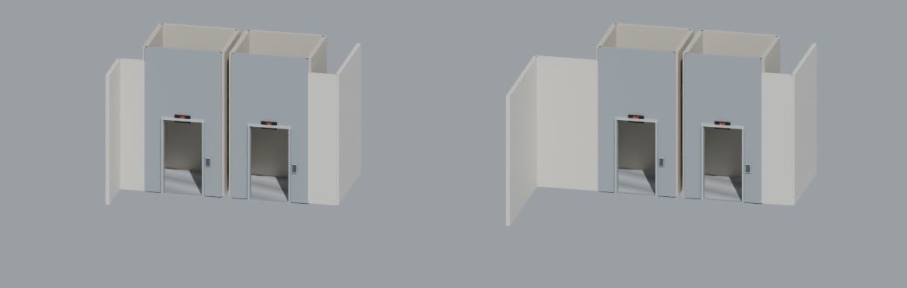

# 신세계 강남점 본관 7층·8층 고객 승강장

[편집 가능한 Blender 원본](landings.blend)의 씬 선택기에서 7층과 8층을 전환할 수 있다. 각 층에는 게임의 두 승강기 출입구, 문틀, 호출부, 바닥, 벽체와 승강장 양옆의 꺾인 벽 네 면이 있다. 8층 가운데의 층별 안내와 추가 문틀 마감은 [기존 전용 원본](../ssg-lift-directory/README.md)에서 편집한다.



공식 층별도는 본관 고객 승강장 앞 통로와 양쪽 벽이 꺾이는 위치를 보여준다. 7층과 8층은 도면을 따로 맞췄으며 두 승강기의 간격과 깊이는 게임 치수다. [강남점 공식 층별안내](https://www.shinsegae.com/store/floor.do?storeCd=SC00002)

컬렉션은 `MainLiftLanding7F`와 `MainLiftLanding8F`다. 도시 배치 스크립트가 각 층의 도면 기준점에 컬렉션 하나씩을 연결한다. 도면이 바뀌면 게임의 벽과 승강기를 수정한 뒤 아래 명령으로 원본을 다시 생성할 수 있다. 이 작업은 원본에서 직접 편집한 메시를 덮어쓴다.

```sh
blender -b --factory-startup -t 4 --python-exit-code 1 --python assets/models/shinsegae-upper-lift-landing/build.py
blender -b --factory-startup -t 4 --python-exit-code 1 --python assets/models/shinsegae-upper-lift-landing/check.py
node tests/shinsegae-lift-landings.mjs
```

도시 배치 검사는 각 층 2,940개 삼각형의 정점·UV·색을 게임 출력과 대조한다. 게임의 E 메뉴 보행 검사에서는 8층에서 7층으로 내려갔다가 8층의 승강장으로 복귀했다.
