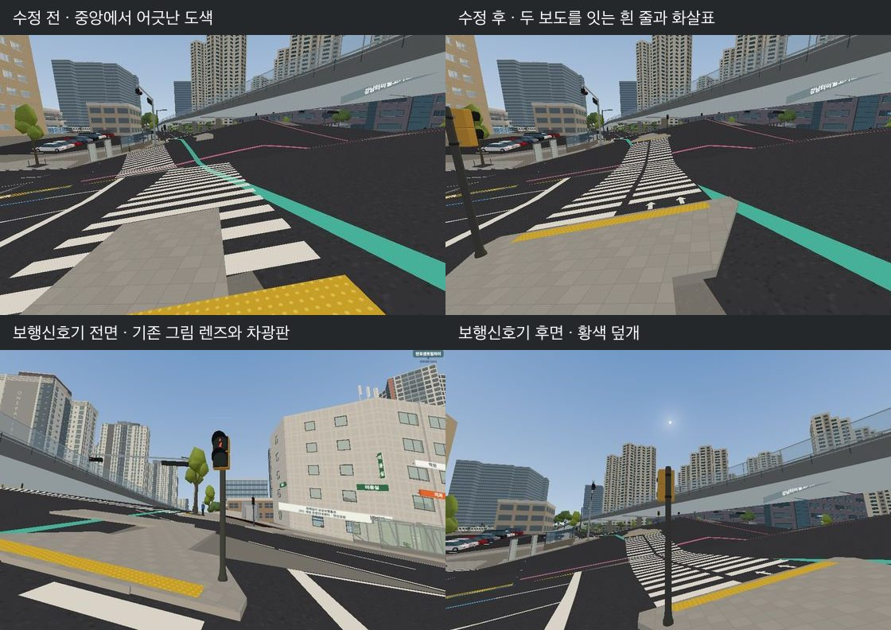

# 신반포로 반포센트럴자이 앞 횡단보도

반포고가 아래 횡단보도에서 보이는 황색 보행신호기 뒷덮개, 보행자 그림 렌즈, 차도 중앙까지 이어지는 흰 줄과 두 개씩 나란한 진입 화살표를 반영했다. 그림 렌즈와 차광판은 기존 고속터미널역 Blender 모델을 재사용했다. 표시된 보행자 그림은 게임의 고정 장면이다. [2026년 1월 네이버 거리뷰, 횡단보도 입구](https://map.naver.com/p?p=AzF8JFjEQ8CMKFS2QwplgQ,-152,12,74,Float) · [맞은편 도색과 신호기](https://map.naver.com/p?p=AzF8JFjEQ8CMKFS2QwplgQ,-40,12,74,Float)

서울시의 2026년 3월 횡단보도 자료와 8월 위치 자료에 동일 관리번호 06-0000054703이 나온다. 8월 자료의 ‘교차로 및 횡단보도 시설 위치정보’ 시트 12968행에는 이단(화살표있음), 신호등 유, 강남터미널고가밑으로 기록되어 있다. 이 행의 대표점에서 게임 양 끝의 중점까지 평면거리는 0.86m다. [서울시 횡단보도 자료](https://data.seoul.go.kr/dataList/OA-22906/S/1/datasetView.do) · [서울시 교차로 및 횡단보도 위치정보](https://data.seoul.go.kr/dataList/OA-23081/F/1/datasetView.do)

게임 양 끝은 공개 보행선의 첫 점과 끝점이다. 네 점을 이은 지도상 거리는 WGS84 기준 24.10m, 게임 평면에서는 24.01m다. 이전 장면은 각 차도의 축에 도색을 따로 맞춰 중간에서 약 4.3m 어긋났다. 두 차도에 걸친 도색을 보행선에 맞췄고 이 구간에서 겹치던 차량용 색깔 유도선을 잘랐다. 폭 5m는 기존 게임값이며 도색 폭·기둥의 보도 가장자리 이격은 사진 비례에 따른 근사다. 바닥 높이는 기존 게임 지형 보간값을 쓴다. 표기 거리는 지도 추정이며 현장 측량값은 없다. [OpenStreetMap 보행선](https://www.openstreetmap.org/way/1481658423)

[횡단보도 보행 시점](https://minwoo19930301.github.io/gangnam-terminal-world/#/street?p=-322.16,0.15,-13.77,-167.83,-10) · [신호기 전면](https://minwoo19930301.github.io/gangnam-terminal-world/#/street?p=-318.30903,0.15,-10.87013,20.69719,10)

## 편집과 확인

- `signal.blend` 안의 `SinbanpoPedestrianHead` 컬렉션을 편집한 뒤 백그라운드 Blender에서 `export.py`를 실행하면 게임용 `signal.glb`를 다시 만든다. `build.py`는 기존 신호기 원본으로부터 새 원본을 재구성한다.
- 통합 도시 생성 시 `world/indoor-layout.mjs`가 동일한 두 기둥을 링크한다. `world/build.mjs`와 `world/roads.py`는 게임과 같은 `layout.js`로 도색과 보도 접속부를 생성한다. Blender 테스트에서 흰 도색 56면의 수평 꼭짓점 오차는 최대 0.016mm였다.
- 저장소 루트에서 `node assets/models/sinbanpo-crossing/check.mjs`를 실행하면 일반 거리 화면에서 도색·중앙 틈을 광선으로 검사한 뒤 W로 양방향 횡단한다. 재현 시 양쪽 모두 반대편 끝에 도착했고, 각 페이지가 상세 신호기를 한 번씩 받았다. 주야간 별도 검사에서 뒤돌거나 130m 떨어져 출발한 페이지의 상세 모델 요청은 0회였다.
