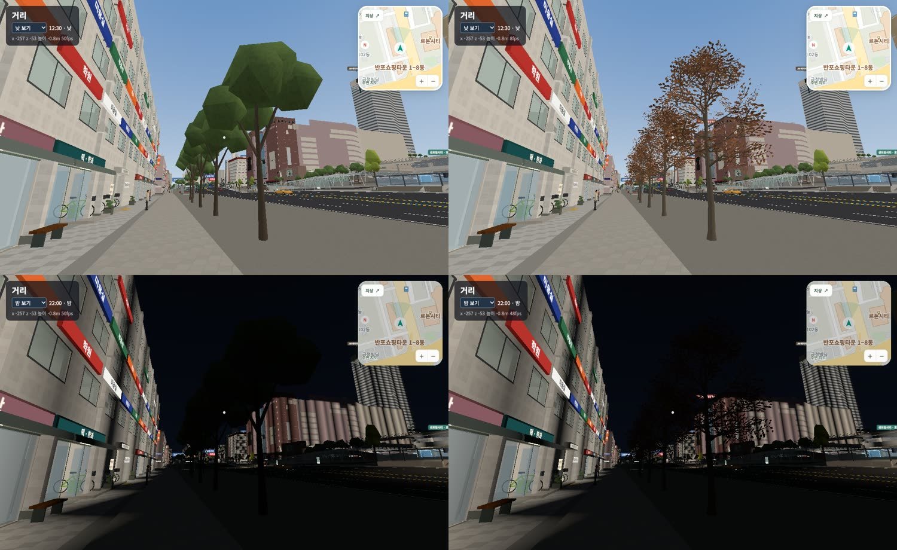

# 신반포로 공도 대왕참나무

반포센트럴자이 앞 보도에서 기존 가로수 열을 바라본 게임 화면이다. 왼쪽이 변경 전이고 오른쪽이 변경 후다. 위는 서울 시각 12시 30분, 아래는 22시다.



서울시 2026 가로수 위치정보 서초구 시트에서 이 보도의 수종은 대왕참나무로 기록된다. 대장에 있는 열 그루의 위치를 사용했다. 수고 자료가 없어 기존 8m를 유지했다. [서울시 가로수 위치정보](https://data.seoul.go.kr/dataList/OA-23040/S/1/datasetView.do)

공도에서 찍은 거리뷰에서 1월과 2월에는 갈색 마른 잎 사이로 큰 가지가 드러나고, 3월에는 빈 잔가지가 보인다. 4월 새잎은 5월의 녹색 수관보다 성기고 10월에는 녹색과 갈색이 섞인다. 다른 해의 사진을 대조한 결과라 해마다 잎이 떨어지고 돋는 날짜와 개별 가지 형태는 근사했다. [1월 거리뷰](https://map.naver.com/p?p=j4hVXLg9uKtKA15PYSPuAw,335,0,78,Float) · [2월](https://map.naver.com/p?p=-1nK9EvBipdI4tPd1ipVmQ,-25,0,78,Float) · [3월](https://map.naver.com/p?p=IZSAZ8Sj-wSrBv9OtmkC0A,-25,0,78,Float) · [4월](https://map.naver.com/p?p=g7oRrLAVaeO-Ik27TEUF8A,-25,0,78,Float) · [5월](https://map.naver.com/p?p=T3HBEO5KGqWoPQSLkOyDXQ,-25,0,78,Float) · [10월](https://map.naver.com/p?p=rdNEqhTBZiKmALQOYk8sPw,-25,0,78,Float)

원본에서 중심줄기, 높이별 곁가지, 접힌 잎가지와 원거리 윤곽을 편집할 수 있다. 잎 모양과 마른 잎의 잔류는 수종 자료도 참고했다. 잎과 수피 무늬는 직접 생성했다. 근접 모델은 열 그루가 한 파일을 공유하며, 잎에는 기존 가로등과 하늘빛이 비친다. [대왕참나무 수형과 잎 · NC State Extension](https://plants.ces.ncsu.edu/plants/quercus-palustris/)

저장된 pin-oak.blend에서 편집한 뒤 같은 디렉터리에서 아래 명령으로 게임용 GLB와 원거리 윤곽을 다시 내보낸다.

```sh
blender -b -t 4 pin-oak.blend --python-exit-code 1 -P build.py -- --export-current
```
