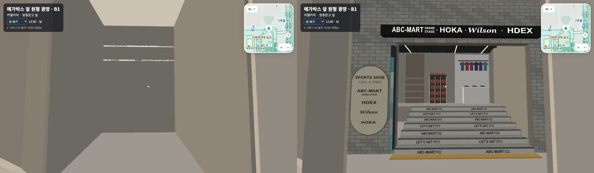

# 스포츠 슈 전문관 입구

2024년 3월 23일 방문 사진에는 회색 벽돌, 타원형 SPORTS SHOE 표찰, ABC-MART GRAND STAGE·HOKA·Wilson·HDEX 간판, 노란 점자블록과 흰 계단이 보인다. 첫 단에서 위쪽 판매대까지 보이는 일곱 단에 인쇄된 두 문구를 재현했다. ABC마트는 신세계 강남점 지하 1층 그랜드스테이지의 개점을 별도로 소개했다. [방문 사진](https://lifensook.tistory.com/218) · [ABC마트 개점 소개](https://www.a-rt.com/display/webzine/detail/main?contentsType=10016&wbznSeq=1504&wbznType=N)

2026년 11월 25일 백화점 안내도는 영풍문고 서쪽에 전문관을 표시하고 디어밸런스도 입점 브랜드로 적는다. 도면에서 정확한 출입문 중심은 확인할 수 없다. 게임은 기존 원형 광장의 개방 구간 안쪽에 사진 속 입면과 작은 판매대만 배치했다. 3.73m 폭, 0.27m 디딤판, 0.15m 단높이는 사진 비례에 맞춘 게임 치수다. 광장 바닥은 게임 높이 −6m, 계단참은 −4.95m다. [신세계 강남점 B1 안내도](https://www.shinsegae.com/cms12/SC00002/guide/floor/__icsFiles/afieldfile/2026/11/25/GnV7UuBEdq7K.png)

`entry.blend`의 편집용 컬렉션은 `GangnamSportsShoeEntry`다. 소품 편집 후 저장하고 저장소 루트에서 다음 명령으로 게임용 파일을 갱신한다. 계단 치수는 `layout.js`에서 보행 표면과 빌더가 함께 읽는다. 치수를 바꾸면 먼저 `build.py`로 원본을 다시 생성한다.

```sh
blender -b assets/models/sports-shoe-rotary/entry.blend -P assets/models/sports-shoe-rotary/export.py
```

[camera.json](camera.json)의 주소로 찍은 같은 시점의 게임 화면이다. 왼쪽은 기존 광장, 오른쪽은 입구 추가 후다.


