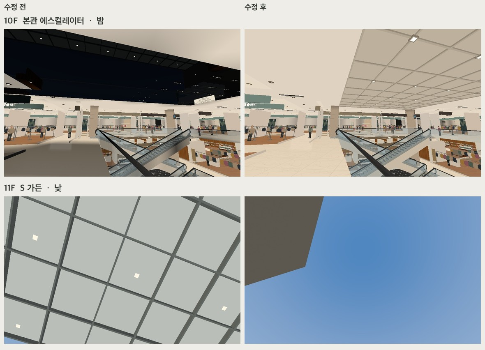

# 신세계 본관 10층 에스컬레이터 천장

9층에서 본관 에스컬레이터를 타고 10층에 도착하면 유아동 매장 사이로 11층 S 가든 바닥의 아랫면이 보인다. 기존 모델에서는 정원 포장이 8 × 22m 개구부 위를 지나면서 포장의 아랫면이 비어 있었다. 아래층에서는 밤하늘이 보였고, 정원에서 위를 보면 실내용 천장이 떠 있었다. 신세계의 10층 고객 안내도에는 본관 에스컬레이터가, 11층 같은 동에는 연속된 정원 바닥이 표시된다. [10층 고객 안내도](https://www.shinsegae.com/cms12/SC00002/guide/floor/__icsFiles/afieldfile/2026/10/22/AbB8151XlKhY.png) · [11층 고객 안내도](https://www.shinsegae.com/cms12/SC00002/guide/floor/__icsFiles/afieldfile/2026/08/19/aelsFO7X4KMf.jpg) · [신세계가 공개한 S 가든 사진](https://www.shinsegaegroupnewsroom.com/shinsegae-gangnam-stores-garden-of-light/)



기존 프레임 천장을 정원 바닥 아래로 옮기고, 등테·반사갓·오팔 렌즈를 개별 메시로 만들었다. 세부 치수와 20개 등의 간격은 기존 게임의 프레임 표현을 본관 에스컬레이터 폭에 맞춘 값이다. 현장 천장 실측 자료는 확보하지 못했다. 게임에서는 렌즈만 스스로 빛나고 프레임과 패널에는 실내 조명이 비친다. 한 번에 받는 상세 모델은 13,640바이트, 1,236삼각형이고 한 번의 그리기 호출을 쓴다.

## Blender에서 편집

[atrium-ceiling.blend](atrium-ceiling.blend)의 **본관 에스컬레이터 · 천장 프레임** 컬렉션에서 편집한다. 등기구와 가로·세로 프레임을 개별 선택할 수 있다. 통합 도시에 기록한 장착 높이는 게임의 11층 포장보다 0.60m 아래다. 편집 파일을 저장한 뒤 프로젝트 루트에서 다음 명령으로 게임 상세 모델을 갱신한다.

```sh
blender -b assets/models/ssg-atrium-soffit/atrium-ceiling.blend \
  --python-exit-code 1 -P assets/models/ssg-atrium-soffit/export.py
```

## 실제 게임에서 확인한 범위

- 정상 지도에서 10층 본관 아트리움, 베이비 디올, 펜디키즈, 스누피 플레이스를 골라 네 방향씩 낮과 밤에 확인했다. 수정 전 하늘이 가장 많이 드러난 시점은 각각 20.70%, 7.05%, 3.68%, 0%였고, 수정 후에는 32개 시점 모두 0%였다.
- 11층 정원 같은 위치에서 올려다본 화면의 하늘은 0.3%에서 84.2%로 늘었다. 그 자리에선 10층 천장 파일 요청이 없었다. 10층에서 천장 쪽을 보고 시작하면 한 번, 등을 돌리면 0번을 기록했다.
- 9층에서 10층으로, 10층에서 9층으로 움직이는 디딤판에 선 채 도착해 반대쪽 보행면까지 걸어 나왔다. 두 방향 모두 기존 층고를 유지했다. [재현에 사용한 10층 카메라](camera.json) · [천장·옥상 회귀 검사](../../../tests/shinsegae-atrium-ceiling.mjs)
