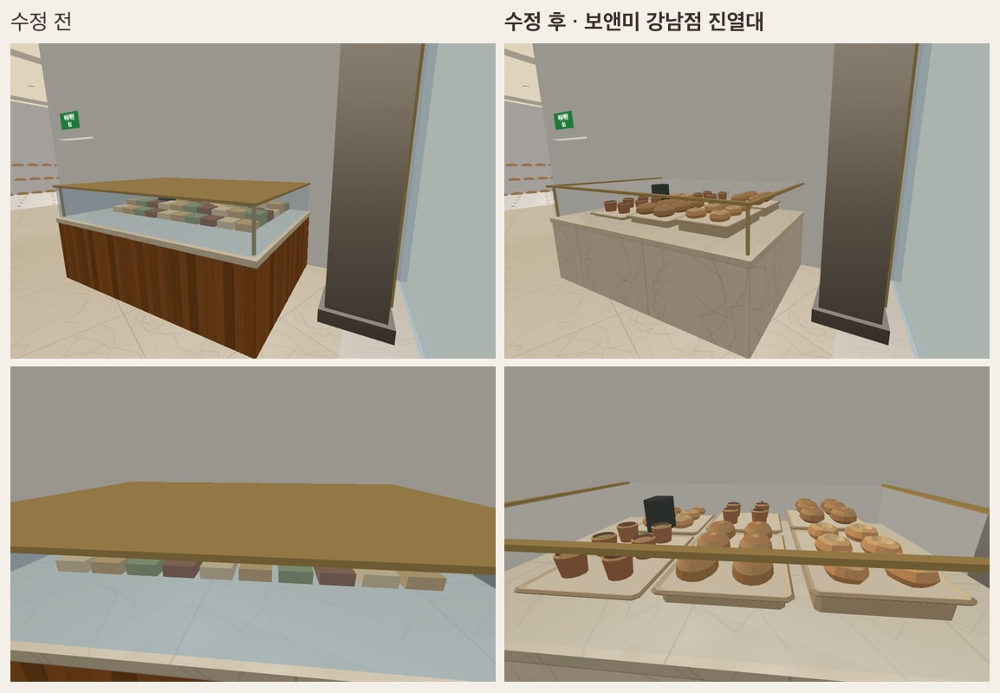

# 보앤미 강남점 지하 1층 베이커리 진열대



신세계푸드가 공개한 강남점 사진에는 밝은 석재 카운터에 검은 BO&MIE 글자가 있고, 유리 너머로 빵을 종류별로 나눠 진열한 모습이 보인다. 같은 보도자료의 메뉴 사진을 참고해 가운데가 오목한 비엔누아즈, 크림과 견과류를 채운 쿠키 샷, 칼집을 낸 르방을 만들었다. 기존 지하 1층 도면의 보앤미 셀에서 계산대와 연결된 유리 진열대를 사용했다. 트레이의 치수·배열과 빵의 수량은 게임용 구성이다. [신세계푸드 강남점 개장 자료](https://www.shinsegaegroupnewsroom.com/shinsegae-foods-parisienne-bonami-launch/) · [강남점 매장 사진](https://images.shinsegaegroupnewsroom.com/wp-content/uploads/2025/08/shinsegae-foods-parisienne-bonami-launch.png) · [메뉴 사진](https://images.shinsegaegroupnewsroom.com/wp-content/uploads/2025/08/shinsegae-foods-parisienne-bonami-launch_3.png)

비교 사진은 왼쪽이 수정 전, 오른쪽이 수정 후다. 카운터 옆 통로 2.7m를 따라 50개 지점에서 지면 높이와 플레이어 충돌을 검사했다. 양쪽 버전 모두 지면이 −6m였고 몸이 밀린 지점은 없었다. 같은 통로를 이동 키로 걸었을 때 두 버전 모두 약 2.31m 전진했다. [카운터 옆 보행 시점](https://minwoo19930301.github.io/gangnam-terminal-world/?pitch=-17.1887#/shinsegae/B1?p=-74.058258,-6,38.019741,116.3835)

`pastries.blend`의 `BOandMIE_B1` 컬렉션에 트레이와 빵 세 종류를 나눠 두었다. 게임에서는 하나의 상세 메시로 묶고 카운터 근처에서만 내려받는다. 편집 후 프로젝트 루트에서 다음 명령으로 내보낸다.

```sh
blender -b assets/models/ssg-bonmie/pastries.blend -P assets/models/ssg-bonmie/export.py
```
