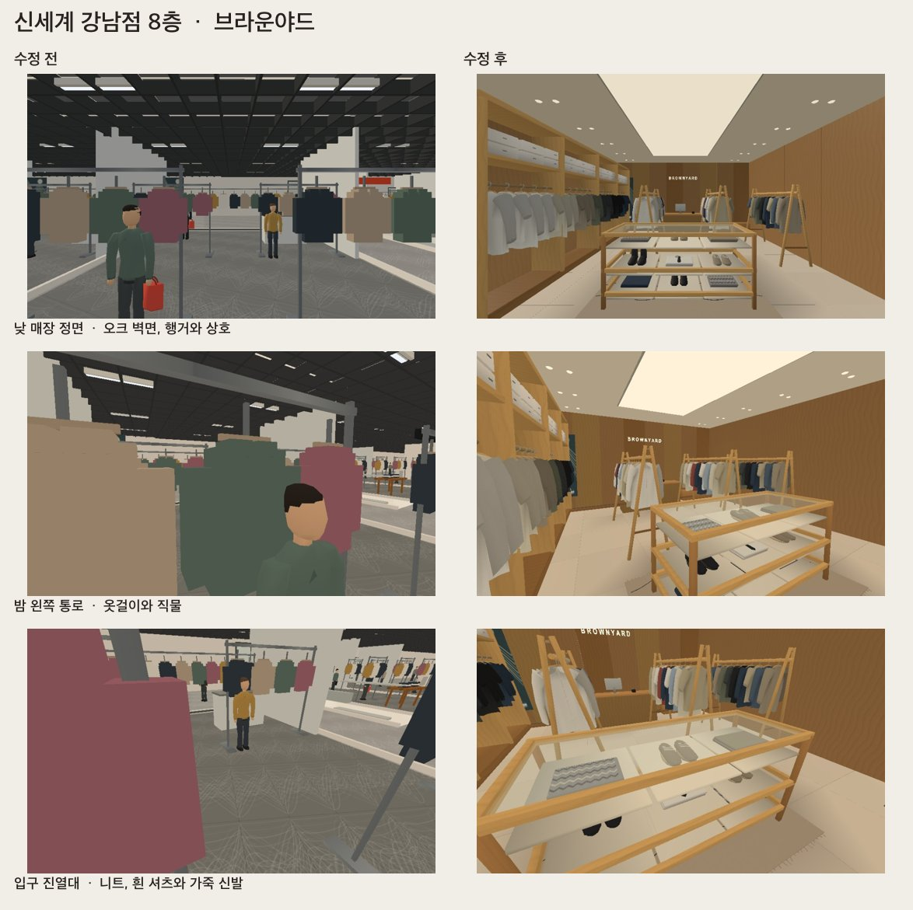

# 브라운야드 · 신세계 강남점 8층

브랜드의 매장 목록에서 ‘브라운야드 신세계 강남점’에 붙은 사진을 기준으로 오크 벽면과 흰 입체 상호, 밝은 목재 행거, 구두 상자가 놓인 벽 선반, 입구 유리 블록과 진열대를 만들었다. 진열대에는 사진에서 식별되는 무늬 니트와 흰 셔츠·검은 타이, 가죽 신발을 배치했다. [브랜드가 공개한 강남점 정면 사진](https://cafe24.poxo.com/ec01/kjkj9252/6aDrbsrpgztyixM+aENnH25T/spThuaXoki+4bxZcbTv0VBqvM0d6PQVde3B3vYTtfW9F9+g+YKioDYTwCxd2Q==/_/byimg/store-by-4.jpg) · [브랜드 매장 사진 및 주소](https://www.brownyard.co.kr/stores.html) · [신세계 강남점 공식 층별 안내](https://www.shinsegae.com/store/floor.do?storeCd=SC00002)

게임 속 위치와 열린 통로 방향은 기존 8층 매장 구획을 따른다. 행거 길이, 의류 수량·색 구성, 구두 디자인과 목재 결은 공개 사진을 해석한 모델이다. 니트와 목재의 반복 무늬는 원본 사진을 복사하지 않고 제작했다.

[매장 정면](../../../index.html#/shinsegae/8F?p=-68.13048,35.80000,22.50607,110.85018,0.00000) · [측면 행거](../../../index.html#/shinsegae/8F?p=-68.79068,35.80000,24.58061,82.88811,-4.00000) · [입구 진열대](../../../index.html#/shinsegae/8F?p=-69.44781,35.80000,23.62250,84.44168,-27.00000)



기존 야간 화면에서도 옷걸이는 보였다. 새 모델은 나뭇결, 옷감과 매장 사인으로 점포를 식별할 수 있도록 했다. 조명 패널은 발광 재질을 쓰고 실시간 광원은 추가하지 않았다. 정면에서 한 번 요청한 모델을 다섯 묶음으로 그리며, 낮과 밤 모두 매장 바깥에서 등을 돌린 시야, 불투명한 뒷벽·옆벽 너머, 9층에서는 요청이 없었다. 앞 통로에서 비스듬히 안을 본 시야에서는 정상적으로 불러왔다.

저사양 헤드리스 Chromium에서 같은 길을 W/S로 3분씩 네 차례 왕복했다(수정 전·후·후·전, 총 12분). 총 43,401프레임에서 구간별 p95는 16.7–16.8ms, p99는 16.8ms 이하였다. 양쪽 측면 통로에서는 W 1.56초에 각각 6.57m, 6.58m 전진했고, 진열대 정면에서는 받침 앞에서 멈췄다.

## 원본과 내보내기

`gallery.blend`의 `SSG_8F_Brownyard`가 통합 도시용 컬렉션이다. 원본에 목재와 직물 이미지를 패킹했다. 내보내기는 재질별 묶음에 표면의 국소 음영을 저장한다. 지도 카메라와 컬렉션 매핑은 `camera.json`에 있다.

```sh
blender -b --factory-startup -P assets/models/ssg-brownyard/build.py
blender -b --factory-startup assets/models/ssg-brownyard/gallery.blend -P assets/models/ssg-brownyard/export.py
```
