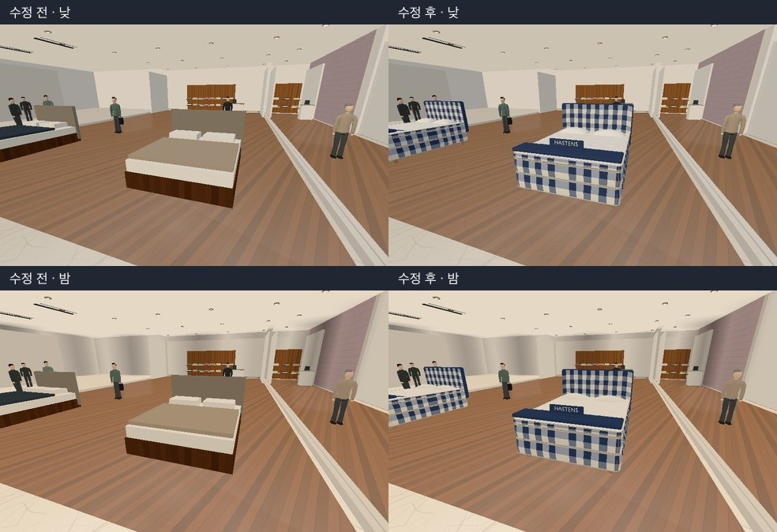

# 신세계 강남점 9층 해스텐스

2026년 11월 강남점 층별 안내의 홈인테리어 매장 목록과 도면에 해스텐스가 있다. 2020년 8월 신세계가 공개한 강남점 침대 행사 사진에서는 체크 헤드보드, 밝은 베개, 층이 나뉜 체크 침대와 발치의 짙은 남색 침구가 보인다. 브랜드 자료에서도 블루 체크 원단과 별도 상단 매트리스를 확인할 수 있다. [강남점 층별 안내](https://www.shinsegae.com/store/floor.do?storeCd=SC00002) · [2026년 11월 5일 9층 도면](https://www.shinsegae.com/cms12/SC00002/guide/floor/__icsFiles/afieldfile/2026/11/05/YOKV7v0iSs2u.png) · [2020년 신세계 제공 사진](https://img.newspim.com/news/2020/08/11/2008110831076750.jpg) · [해스텐스 2000T 제품 자료](https://www.hastens.com/en/beds/2000t)

기존 게임의 두 침대 자리에 이 특징을 반영했다. 진열 수량과 방향은 기존 게임 배치에서 가져왔고, 1.70 × 1.98m 본체, 상호 카드, 파이핑과 누빔 간격은 모형에 맞춰 정했다. 현재 이 매장이 판매하는 정확한 모델과 침구 조합은 확인되지 않았다.



[게임에서 매장 보기](../../../?pos=-83.65597,40.6,-14.77184&yaw=38.7&pitch=-17#/shinsegae/9F)

## 편집과 로딩

Blender 원본은 `gallery.blend`의 `SSG_9F_Hastens` 컬렉션이다. 두 침대의 바닥 중앙을 각각 원점으로 같은 컬렉션을 배치한다. 원단 면, 헤드보드, 베개, 둘레 끈, 매트리스, 다리와 상호 카드를 82개 메시로 나눠 편집할 수 있다. 게임에서는 한 침대당 단일 메시로 그린다. 두 침대가 61,932바이트 상세 파일 하나를 공유하며, 한 침대는 6,643삼각형이다. 카메라에서 9m 이내의 매대가 시야에 들어올 때 상세 모델을 요청한다.

침대 외곽에서 전진하면 발치 앞에서 멈춘다. 두 침대 가운데에서는 같은 층을 유지하며 5.67m를 걸었다. 일반 보행 시점에서 두 침대를 볼 때는 상세 파일을 한 번 받았고, 등을 돌린 상태에서 새로 접속하거나 같은 좌표의 위층과 아래층에 접속했을 때는 요청이 없었다. 820 × 510 저사양 설정의 Chromium Metal에서 두 침대 사이를 같은 키 입력으로 26초씩 왕복했을 때 수정 전후 모두 1,560프레임을 측정했고, 프레임 간격은 p95 16.7ms, p99 16.8ms였다.

같은 저사양 프로필로 공개 통로에서 머무르며 15초마다 좌우로 걸어 본 600초 연속 측정에서는 35,999프레임, p95 16.7ms, p99 16.8ms를 기록했다.

```sh
blender -b --factory-startup -P assets/models/ssg-hastens/build.py
node tests/smoke.mjs shinsegae
node assets/models/ssg-hastens/check.mjs --soak
```
