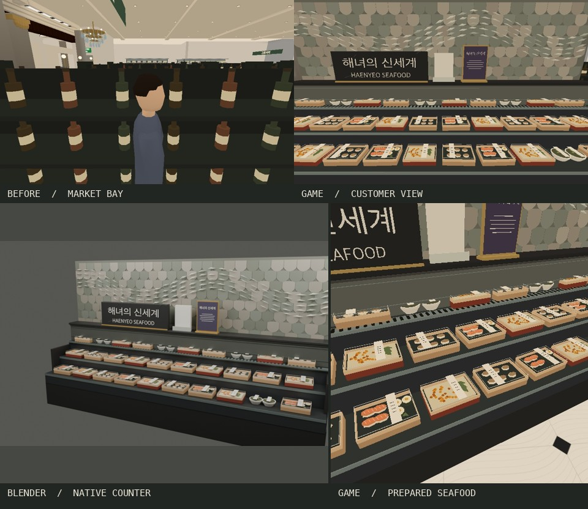

# 신세계 마켓 · 해녀의 신세계

2025년 2월 강남점에 문을 연 제주 해산물 매대다. 간판의 한글과 영문 글자, 물고기 떼와 조개 비늘을 표현한 벽, 진열장 세 단, 보라색 메뉴판은 개점 당시 현장 사진을 보고 만들었다. 나무 도시락과 컵에 감긴 종이 띠는 신세계가 촬영한 매대 영상에도 보인다. 진열 상품의 종류와 수량, 매대 치수는 재구성했다. 게임에서는 기존 마켓 수산 코너의 진열대 한 칸을 사용했다. 매장 내 위치에는 현장 실측 오차가 있을 수 있다. [신세계 뉴스룸](https://www.shinsegaegroupnewsroom.com/shinsegae-market-new-standard-opening/) · [개점일 현장 사진](https://www.dnews.co.kr/uhtml/view.jsp?idxno=202502281617214680475) · [신세계 매대 영상 1분 28초](https://www.youtube.com/watch?v=5BW2sr8C0LU&t=88s)



[Blender 편집 원본](counter.blend)의 **SeafoodCase**에 석재·금속·글자가 있고 **SeafoodPacks**에서 도시락과 해초 컵 34개의 위치와 방향을 편집할 수 있다. 상품 한 종류의 구성을 바꾸면 같은 종류의 상품에 함께 반영된다. 파일을 열면 진열대 카메라가 선택된다.

게임에서 **M → 해녀의 신세계 → 여기로 이동**을 누르면 주문대 앞에 도착한다. 진열장은 고객이 보는 방향에서 53,840바이트를 불러온다. 매대 가까이에서는 상품 네 종류가 50,036바이트 파일 하나와 네 번의 인스턴스 드로를 공유한다. 상층과 매대 뒤쪽에서는 두 파일을 요청하지 않는다.

상품과 매대를 편집한 다음 저장한 파일에서 아래 명령을 실행하면 게임용 모델과 상품 위치를 내보낸다.

```sh
blender -b assets/models/ssg-market-haenyeo/counter.blend --python-exit-code 1 -P assets/models/ssg-market-haenyeo/export.py
```
