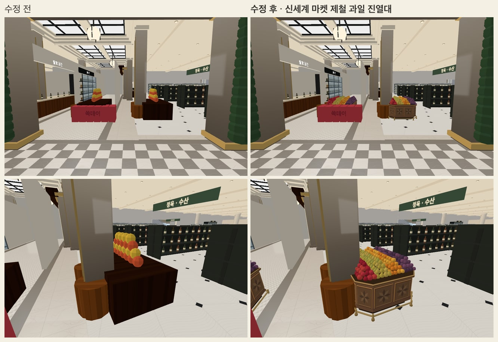

# 신세계 마켓 제철 과일 진열대



신세계백화점 강남점 지하 1층 마켓 개장 사진에는 모서리를 접은 짙은 목재 진열대와 액자 모양의 장식 패널, 바닥 가까이에 둘러친 황동 봉, 색깔별로 쌓은 과일이 보인다. 이 네 가지를 기존 입구 안쪽의 진열대 두 자리에 맞춰 모델링했다. 목재 패널의 꽃무늬와 사과·배·감귤·자두의 배열은 사진을 바탕으로 구성했다. 진열대 치수와 배치는 기존 게임 도면을 따랐으며 실제 매대의 실측값과 재고는 확인되지 않았다. [신세계그룹 뉴스룸 개장 보도자료](https://www.shinsegaegroupnewsroom.com/shinsegae-market-new-standard-opening/) · [공식 강남점 개장 사진](https://images.shinsegaegroupnewsroom.com/wp-content/uploads/2025/08/shinsegae-market-new-standard-opening.png)

비교 사진은 왼쪽이 수정 전, 오른쪽이 수정 후다. 위는 동측 입구, 아래는 매대에 다가선 시점이다. [입구 시점](https://minwoo19930301.github.io/gangnam-terminal-world/?pitch=-5.73#/shinsegae/B1?p=-60.70116,-6,25.7314,111.264) · [진열대 시점](https://minwoo19930301.github.io/gangnam-terminal-world/?pitch=-16.616#/shinsegae/B1?p=-64.17775,-6,26.67663,86.107)

## 제작과 배치

`fruit-island.blend`의 `MarketProduceIsland` 컬렉션에서 목공, 발받침, 패널과 네 종류의 과일을 나눠 편집할 수 있다. 게임은 두 매대를 한 번에 그린다. 카메라에 들어온 매대가 19m 이내이면 상세 모델을 한 번 내려받으며, 22m를 넘어가면 간단한 모형으로 전환한다. 월드 좌표와 회전값은 [camera.json](camera.json)에 있다.

편집 후 프로젝트 루트에서 다음 명령으로 게임 파일을 내보낸다.

```sh
blender -b assets/models/ssg-market-produce/fruit-island.blend -P assets/models/ssg-market-produce/export.py
```
