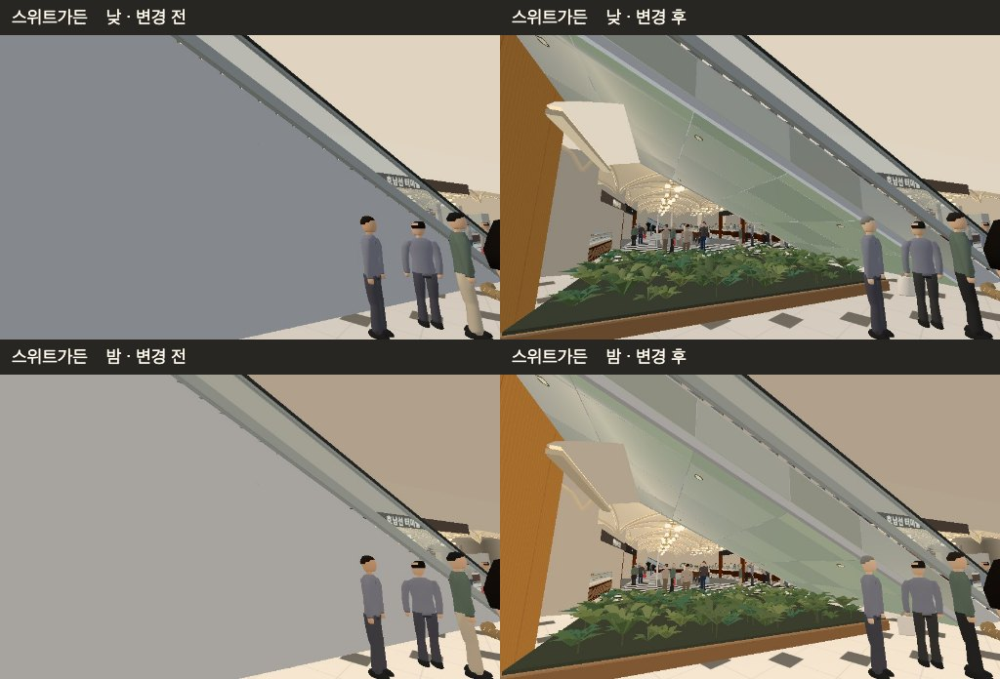

# 스위트가든 에스컬레이터 하부

2024년 3월 12일 현장 사진에서 에스컬레이터 밑으로 이어지는 은색 패널의 이음매, 원형 매입등과 금속 테두리 안의 식재를 확인할 수 있다. 2026년 11월 25일 운영사 도면에서 스위트가든 위치를 확인했다. 패널 치수·분할 수와 식물 배치는 게임 속 네 대의 경사와 폭에 맞춰 근사했다. 현재도 같은 수종과 장식이 놓여 있는지는 확인되지 않았다. [현장 사진](https://starrydream.tistory.com/236) · [운영사 소개](https://www.shinsegaegroupnewsroom.com/go-field-life-dessert-renewal-2/) · [강남점 B1 도면](https://www.shinsegae.com/cms12/SC00002/guide/floor/__icsFiles/afieldfile/2026/11/25/GnV7UuBEdq7K.png)

기존 플레이에서는 네 대 각각의 하부가 회색 벽으로 바닥까지 막혀 있었다. 기존 발판, 빗살판, 손잡이와 모터는 유지하고 공통 하부 마감과 화단을 붙였다. 패널의 색은 시점과 법선에 따라 달라진다. 추가 광원과 반사 렌더 타깃은 사용하지 않는다.

## Blender 편집

`soffit.blend` 안의 `SweetGardenBankSoffit` 컬렉션을 수정한 뒤 이 디렉터리에서 `blender -b soffit.blend -P export.py`를 실행한다. 원점은 지하 1층 하부 승강판의 네 대 중앙이며 Blender +Y가 상행 방향이다. `build.py`는 최초 형태를 재생성한다. 월드의 indoor-layout에서 편집용 컬렉션 배치를 가져온다.

가까운 지하 통로에서만 67,576바이트 GLB 한 개를 요청한다. 메시 한 개, 드로 한 번, 삼각형 5,829개다. 최초 진입 실험에서는 지하에서 하부를 보는 세 시점에서 각각 한 번 요청했고, 같은 층에서 등을 돌리거나 위층에 서서 시작한 경우에는 요청하지 않았다. 매칭된 전체 통로 시점에서 게임이 집계한 드로 수는 낮·밤 모두 815에서 817로 바뀌었다.
