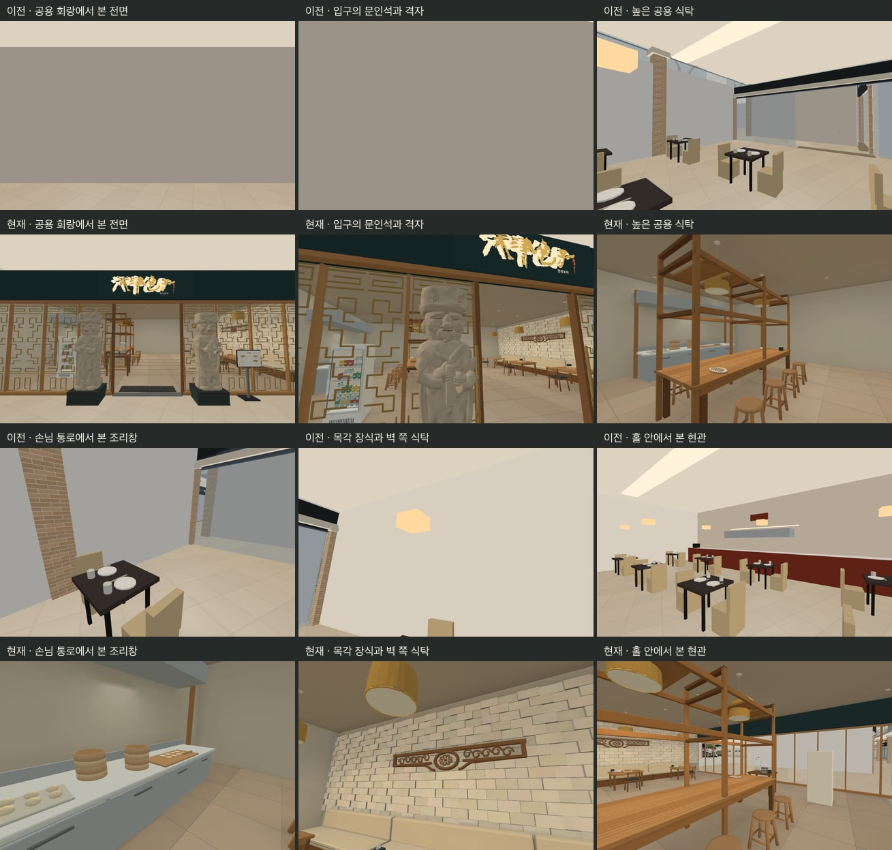
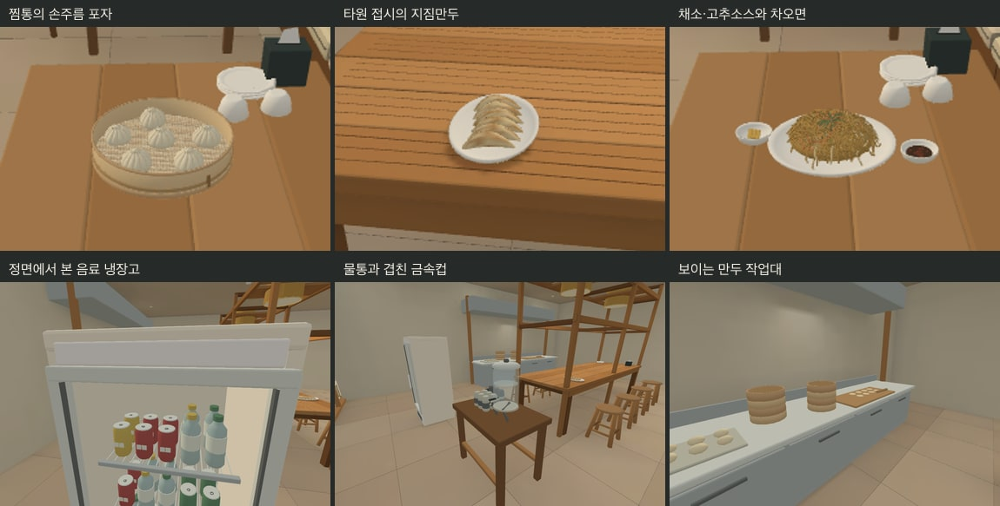
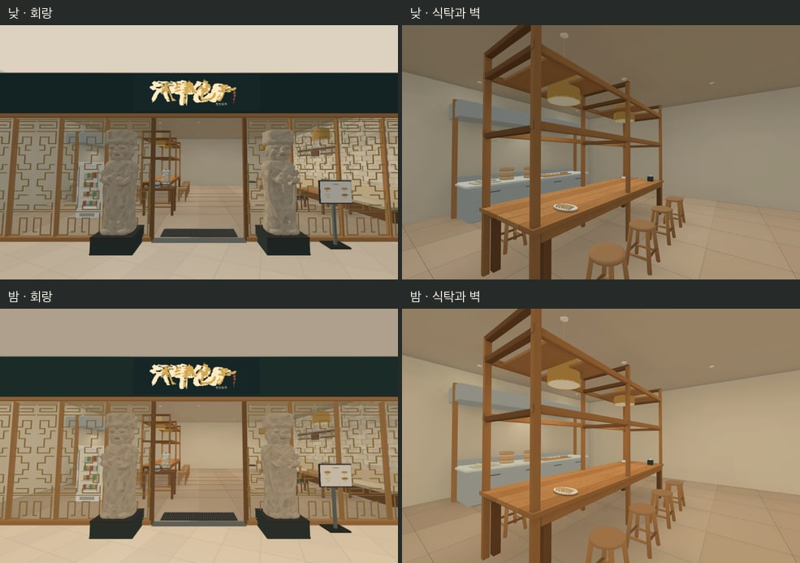

# 천진포자 · 파미에스테이션 1층 116호

1층 공용 회랑에서 두 문인석 사이로 들어와 높은 목제 공용 식탁, 벽 쪽 작은 식탁, 음료 냉장고와 만두 조리창 앞까지 걸을 수 있다. 네이버 지도는 서울 서초구 사평대로 205 파미에스테이션 1층 116호를 안내한다. 신세계 센트럴 1층 안내도에서는 8번 점포다. [네이버 지도](https://map.naver.com/p/entry/place/36311153) · [운영사 점포 안내](https://www.shinsegaecentral.com/famille/TianjinBaozi) · [1층 안내도](https://www.shinsegaecentral.com/public/img/famille_floor_1_ko_map.png)

운영사 전면 사진의 금빛 ‘天津包子’와 붉은 낙관, 나무틀 안의 금속 격자, 두 손으로 홀을 쥔 문인석, 왼쪽 메뉴판, 안쪽의 흰 냉장고를 참고했다. 내부 사진에는 크림색 요철 벽, 짙은 목각, 황동 원통형 조명, 높은 식탁 위에 세워 둔 찜기, 금속 컵과 물병이 보인다. 운영사 음식 사진 세 장에 나온 대나무 찜통의 포자, 타원 접시의 지짐만두, 작은 종지를 곁들인 차오면을 각각 모델링했다. [운영사 사진](https://www.shinsegaecentral.com/famille/TianjinBaozi) · [방문 당시 식탁과 조리창](https://traveldot.tistory.com/46) · [메뉴와 음식](https://misojuni.tistory.com/89)

기존 게임의 12.06 × 9.63m 점포 칸에 공개된 실내를 맞췄다. 입구는 안내도 8번 옆 가로통로와 전면 사진을 대조해 배치했다. 입구의 정확한 방위, 집기 치수와 수량, 냉장고 재고, 메뉴판의 줄 구성, 당일 놓인 음식과 실제 조명 출력은 추정이다. 계산대 뒤는 손님 통로에서 보이는 작업대와 찜기까지만 구현했다.







## Blender 원본과 게임

[restaurant.blend](restaurant.blend)는 완성된 식당 장면으로 열린다. 다른 장면에서 23개 컬렉션의 개별 메시 1,615개를 편집할 수 있다. 완성 장면은 실제 게임 가구 배치와 면광원 16개를 포함한다. 실내와 공용 식탁은 같은 배치에서 Cycles 96샘플로 구운 조명에 게임의 실시간 조명을 곱한다. 문인석 두 개와 세 음식은 각각 개별 메시 파일로 내려받는다. 격자창, 유리, 스툴은 같은 메시를 여러 위치에서 그린다.

다음 명령은 각각 저장된 편집본의 게임 파일 내보내기, 처음부터 원본 재생성, 실제 게임 보행 검증을 실행한다.

```sh
blender -b assets/models/tianjin-baozi/restaurant.blend --python-exit-code 1 -P assets/models/tianjin-baozi/export.py
blender -b --python-exit-code 1 -P assets/models/tianjin-baozi/build.py
node assets/models/tianjin-baozi/check.mjs
```

보행 검사는 공용 회랑에서 출발해 두 문인석 사이로 들어간 뒤 조리창에 닿고 회랑으로 돌아온다. 10m에서 간판을 바라볼 때 식탁 음식 요청은 0건이었다. 인접 점포·후면·등진 방향에서도 첫 요청은 0건이었다. 냉장고의 불투명한 뒷면을 보면 이미 받아 둔 캔과 병도 숨긴다.

게임 자산은 GLB 21개(합계 1,054,004바이트·125,338삼각형)와 조명 지도 2개(54,740바이트)다. 1m 남짓 떨어진 동일한 보행자 시점에서 차오면의 곡선 면발을 단순화해 25,446삼각형·137,296바이트에서 12,904삼각형·76,724바이트로 줄였다. 접시를 포함한 280 × 190픽셀 영역의 채널별 평균 차이는 255단계 중 0.27이었다. Blender의 고해상도 면발은 그대로 편집할 수 있다.

1000 × 640 게임 화면에서 같은 카메라 좌표·방향 14곳을 각각 72프레임 측정했다. 이 기기의 프레임 간격 95백분위는 전후 모두 16.7~16.8ms였다. 전체 화면의 그리기 호출은 시점별 4~26회, 삼각형은 32,344~109,048개 늘었다. 세 시점에서는 이전 매장의 카운터가 있던 자리에 실제 보행 바닥이 생겼다. 별도의 Blender 검증 장면에서 50개 게임 배치와 편집 원본의 최대 차이는 0.0432mm였다.
