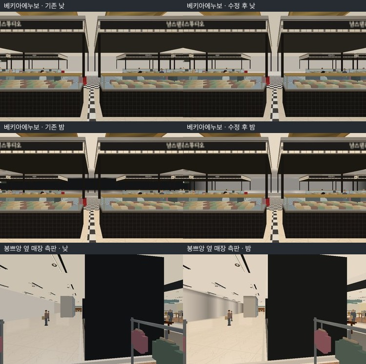

# 신세계 강남점 지하 델리의 야간 조명

베키아에누보 가스트로 카운터에서 보면, 검은 진열장 사이로 보이는 크림색 내벽이 기존 게임에서 밤에만 검게 변했다. 지도상 매장 구역의 끝에서 전기조명도 끊겼기 때문이다. 지하 내벽의 해당 면에 저녁부터 서서히 반사광이 더해지도록 조정했다. 운영사 사진에서는 따뜻한 천장 조명과 밝은 유리 진열대를 볼 수 있다. 먼 벽의 색과 밝기는 게임의 주간 마감에 맞춘 추정이다. [신세계푸드 강남점 개점 사진과 설명](https://www.shinsegaegroupnewsroom.com/european-healthy-gourmet-at-home/)

같은 벽면 35 × 35픽셀의 휘도 중앙값은 밤에 19.9에서 142.3으로 바뀌었고, 낮에는 두 버전 모두 181.8이었다. 값의 범위는 0~255다. 같은 화면에서 검은 진열장 하단은 주간 19.2, 야간 20.4를 유지했다. [지하 1층 게임 시점](../../?pos=-56.48075,-6,-9.74031&yaw=290.78&pitch=0#/shinsegae/B1)

10층 봉쁘앙 옆의 어두운 면은 게임에서 약 2.33m 앞에 있는 몽클레르 앙팡 진열 공간의 차콜색 측판이다. 같은 도착점에서 방향을 돌리면 의류 진열과 밝은 복도가 보인다. 몽클레르 공식 매장 안내에서 강남점 10층 입점을 확인할 수 있다. [몽클레르 매장 안내](https://www.moncler.com/en-us/storelocator/republic-of-korea/seoul/kr11-176-sinbanpo-ro)

실행 검증은 `node tests/shinsegae-deli-light.mjs`로 재현할 수 있다.

저화질 브라우저 탭 하나에서 지도를 열어 두 매장을 번갈아 13회씩 방문했다. 각 매장에서 낮·밤을 바꾸며 26분씩 측정했고, 일반 이동 키로 지하 458m와 10층 488m를 걸었다. 15초 구간별 프레임 시간의 p95 중앙값은 두 매장 모두 16.7ms였다. 가장 긴 한 프레임은 각각 166.6ms와 116.7ms였으며, 52분 동안 WebGL 컨텍스트 손실과 리소스 요청 오류는 관찰되지 않았다.
