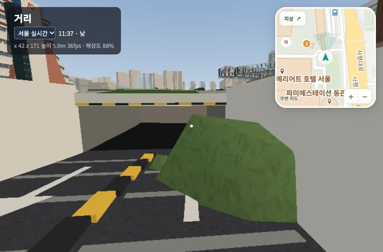
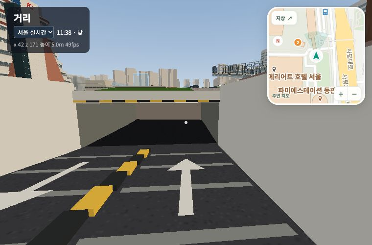
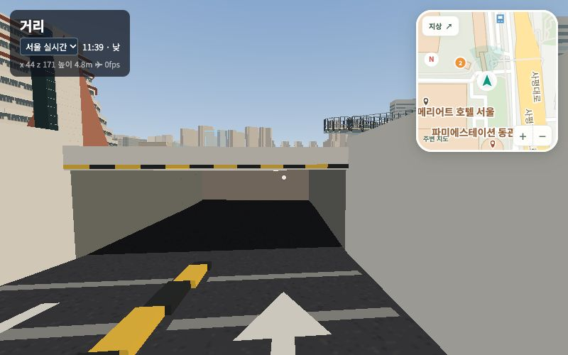
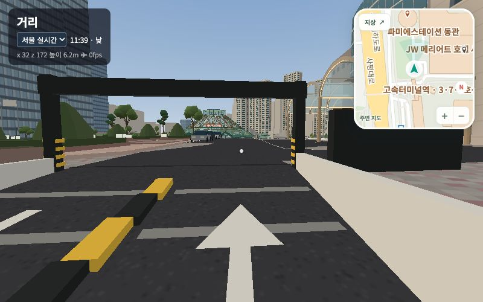

# 파미에주차장 상부 입구

행사장 주차 안내 사진에서 호텔 앞에 파미에 주차장 입구가 보인다. 기존 모델은 거리뷰에 보이는 흰 측벽과 노랑·검정 중앙분리대로 한 경사로의 두 차로를 나눈다. 두 차로의 흰 화살표는 게임 안에서 내려가는 쪽과 올라가는 쪽을 구별하기 위한 표시다. 위치와 도색은 근사다. 행사장 사진에서 파미에로 표시한 두 곳은 모두 입구로 소개된다. [행사장 안내 사진](https://ihcf.or.kr/uploaded/board/scheduling/_5c5692d73c7394d0c337df2a9c688ef71.pdf) · [2024년 3월 네이버 거리뷰](https://map.naver.com/p?p=nOOQgVZmQWe4Z-qIb--3fg,105,0,80,Float) · [신세계 강남점 주차 안내](https://www.shinsegae.com/store/main.do?storeCd=FC00004)

### 하행 차로의 시야

자동 배치된 느티나무 한 그루의 수관이 경사로 안으로 들어와 진행 화살표를 가렸다. 그 배치점을 지운 뒤 같은 게임 주소와 카메라에서 비교했다. 화단의 소나무와 경사로 측벽은 두 화면에 모두 있다.

| 수정 전 | 수정 후 |
|---|---|
|  |  |

### 세단 물리 시험

헤드리스 Chromium이 로드한 거리 씬에서 경사로 표면 높이를 읽어 Jolt의 삼각형 노면을 만들었다. 전륜구동 4륜 시험 차체에 게임 세단의 윤거와 축거를 적용하고, 정차 상태에서 키보드 W로 Jolt의 WheeledVehicleController를 구동했다. 두 방향은 각각 독립 출발했다. 차체 주변의 벽 충돌은 같은 거리 씬에서 검사했다. 아래 사진은 각 주행 끝의 운전자 눈높이를 게임에 재현한 화면이다. 배포판의 기본 W 입력은 보행이며, 이 시험에서 브라우저에 연결한 운전 컨트롤러는 검증용이다.

| 측정 항목 | 하행 | 상행 |
|---|---:|---:|
| 수평 주행 거리 | 15.17m | 15.13m |
| 차체 고도 변화 | −1.79m | +1.78m |
| 네 바퀴 모두 접지한 물리 스텝 | 195 / 195 | 386 / 386 |
| 벽 충돌로 밀려난 거리 | 0m | 0m |
| 운전자 눈높이 |  |  |

정상 게임의 보행자 W 입력으로도 같은 두 차로에서 각각 15.6m 이동했다. 게임 치수와 시험 차체는 현장 실측값이 아니다.
