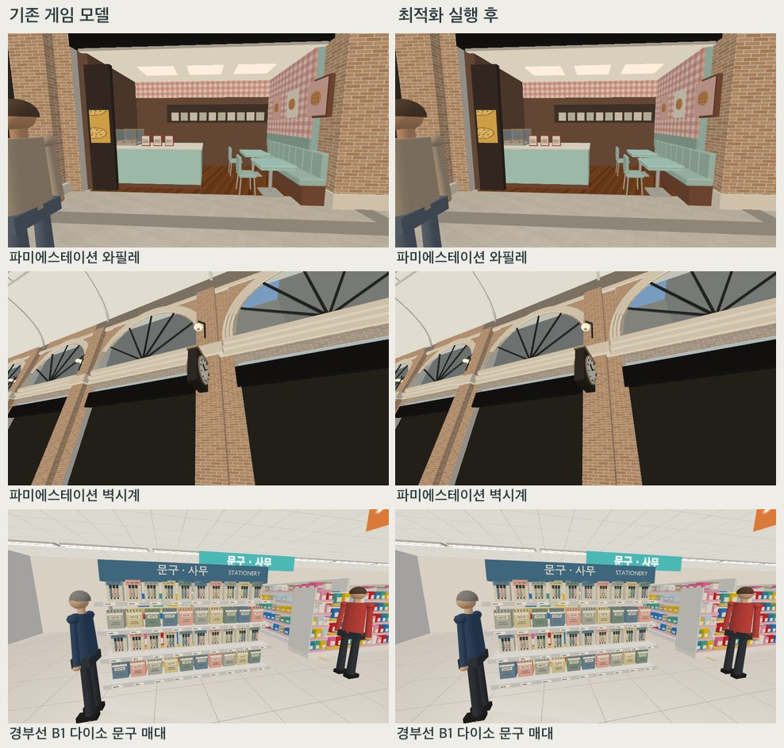

# Blender 집기의 GLB 최적화

| 게임 자산 | 기존 바이트 | 최적화 후보 바이트 | 적용 후 바이트 | 감소 |
| --- | ---: | ---: | ---: | ---: |
| 파미에스테이션 와필레와 벽시계 | 387,732 | 133,676 | 133,676 | 65.52% |
| 경부선 다이소 진열대·간판·계산대 | 785,884 | 838,728 | 785,884 | 0% |
| 경부선 상가 집기 | 274,576 | 301,084 | 274,576 | 0% |

파미에스테이션의 GLB는 254,056바이트 작아졌다. 다이소와 경부선 상가의 기존 파일은 이미 gltfpack 1.3으로 압축되어 있어 더 작은 원본을 유지했다. 표는 파일 크기이며, 실제 다운로드 시간은 전송망과 캐시의 영향을 받는다.

## Blender 내보내기 후 적용

저장소 루트에서 개발 도구를 설치한 뒤 다음 명령을 실행한다. 파일명을 바꾸면 다른 정적 집기에도 적용할 수 있다. 같은 출력 경로를 주면 생성에 성공한 후 파일을 교체한다. 출력 디렉터리는 미리 만들어 둔다.

```sh
npm ci
blender -b assets/models/famille/gallery.blend -P assets/models/famille/export.py
npm run optimize:model -- assets/models/famille/gallery.glb assets/models/famille/gallery.glb
```

glTF Transform 4.5.1의 weld로 속성까지 같은 정점을 합치고, meshoptimizer 1.3.0으로 인덱스와 정점 순서를 정리한 뒤 기존 좌표·노멀·색상 배열을 EXT_meshopt_compression으로 인코딩한다. 블렌딩 투명 재질을 가진 모델에서는 삼각형의 순서를 유지한다. 프로젝트의 three.js r160 GLTFLoader에 기존 다이소 모듈과 같은 MeshoptDecoder를 연결해 파일을 읽는다. 새 장소에서 이 도구를 쓸 때도 GLTFLoader에 같은 디코더를 연결한다. [glTF Transform weld](https://gltf-transform.dev/modules/functions/functions/weld) · [meshoptimizer를 이용한 정점 재정렬](https://gltf-transform.dev/modules/functions/functions/reorder) · [EXT_meshopt_compression](https://github.com/KhronosGroup/glTF/blob/main/extensions/2.0/Vendor/EXT_meshopt_compression/README.md)

## 게임 검증

파미에스테이션 Blender 원본을 헤드리스로 다시 내보내고 위 명령을 적용해 커밋용 GLB와 바이트가 일치하는지 확인했다. 파미에스테이션의 삼각형 5,816개를 양쪽 파일에서 복호화했다. 각 꼭짓점의 위치·노멀·색상 바이트를 연결하고, 면 방향을 유지한 채 삼각형 목록을 비교했다. 벽시계 1,512개와 와필레 4,304개가 각각 일치했다.

Chromium 일반 게임 진입에서 낮 조명과 손님 눈높이 카메라를 고정하고 GLB를 교체해 확인했다. 와필레 주문대와 벽시계에서 각각 800×450 화면 전체의 RGB 차이가 0픽셀이었다. 다이소 문구 진열대는 집기만 표시한 화면의 차이가 0픽셀이었다. 세 시점 모두 모델 다운로드는 HTTP 200이었고 JavaScript·콘솔 오류는 없었다.


