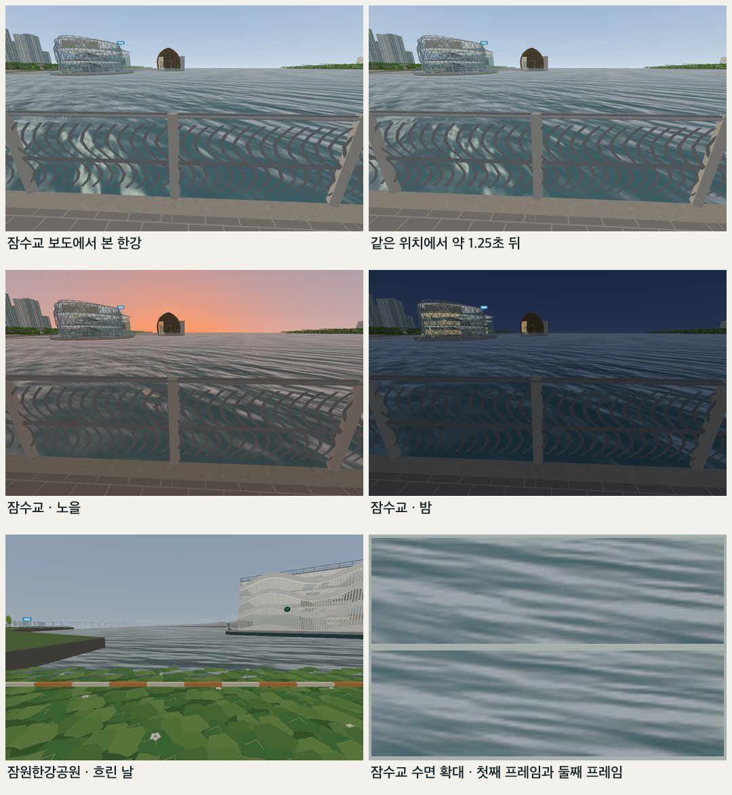

# 반포 한강의 흐름과 수면

잠수교에서 세빛섬 쪽으로 바라보면 물결이 동작대교 방향으로 움직인다. 서울시 반포한강공원 안내의 상류 쪽 경계는 한남대교, 하류 쪽 경계는 동작대교다. 네이버 지도에서 잠수교와 세빛섬, 동작대교의 위치와 강이 굽는 방향을 대조하고 OpenStreetMap 한강 외곽선을 따라 물결 진행 방향을 돌렸다. 게임에서 서쪽으로 이동하는 속도 성분은 초당 0.83m로 정했다. 현장 유속과 시간대별 수위를 측정한 자료는 이번 조사에 포함되지 않았다. [서울시 반포한강공원](https://hangang.seoul.go.kr/www/contents/663.do?mid=463) · [네이버 지도 반포대교 일대](https://map.naver.com/p?c=14136740,4511340,14.00,0,0,2,dh) · [OpenStreetMap 한강 외곽선](https://www.openstreetmap.org/relation/152336)

잠원 나뭇잎 관찰 지점에는 강과 겹치는 25.5×22m의 수면이 별도로 있었다. 모델 좌표의 겹친 면적 약 340.86㎡를 없애고, 나머지 약 220.14㎡는 기존 전망 지점의 물가 모양을 따라 본류 외곽선에 합쳤다. 이 면적은 게임 폴리곤으로 계산했다. 흙 바닥을 자르는 경계와 수면 메시가 같은 외곽선을 쓴다. 잠원 상류 연장 구간에도 같은 수면 재질을 사용한다.

날씨와 시간대에 따라 같은 물결의 반사광과 색이 달라진다. 잠원 우천 구간에 들어가면 하늘이 흐려지고 물결의 기울기가 커진다. 128×128 물결 텍스처 한 장을 서로 다른 크기로 두 번 읽는다. 매 프레임 갱신하는 값은 시간과 흐림 정도이며 별도 반사 렌더 패스는 없다. 큰길 가로등에는 밤에 켜지는 공용 발광 렌즈를 달았다.



## 브라우저 검증

일반 게임 진입 화면의 들어가기 버튼으로 시작해 잠수교 보도에서 카메라를 고정했다. 시야 앞쪽 수면 128×32픽셀의 3×3 표본에서 카메라 광선이 처음 닿은 표면이 모두 한강이었다. 1.263초 뒤 4,096픽셀 중 3,749개에서 RGB 채널 하나 이상이 3단계 이상 변했다. 채널별 평균 절대 변화는 255단계 중 20.49였다. 같은 장면에서 Chromium Metal의 전체 프레임 간격 중앙값은 16.5ms, 드로 호출은 276회였다. 수치는 해당 기기와 시점에서 얻은 값이다.

브라우저 검사는 한강 수면의 공유 재질 수, 밤·낮 가로등 점등, 흐린 전망 지점의 중앙 시선이 실제 수면에 닿는지, JavaScript와 WebGL 오류도 확인한다. 스틸 이미지는 같은 경로에서 찍으며 확대 패널에는 동일한 화면 좌표를 사용했다.

```sh
node tests/river-water.mjs --gpu --out /tmp/han-review
node tests/smoke.mjs hangang jamwon_hangang streets
node tests/walk.mjs jamwon_hangang hangang streets
```
