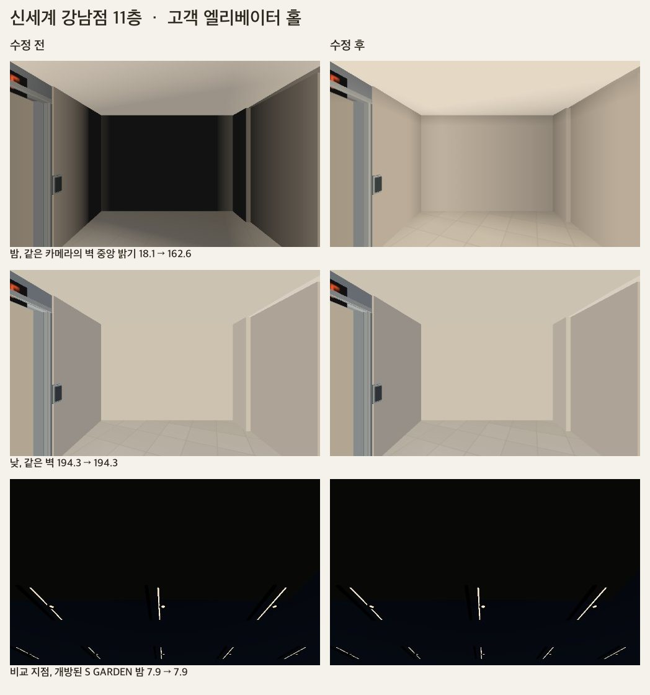

# 신세계 강남점 11층 고객 엘리베이터 홀

11층 지도에서 ‘고객 엘리베이터’를 선택한 뒤 문 옆의 막힌 벽을 바라보면 밤에 벽면 전체가 검게 보였다. 게임에는 복도 천장이 이미 있었다. 홀 끝에서 보이는 천장과 충돌용 천장이 일치하지 않아, 야간 조명을 계산할 때 그 벽을 덮개 없는 곳으로 처리했다. 보이는 천장과 같은 사각형, 같은 높이(게임 바닥 위 2.7m)를 물리 모델에도 등록했다. [강남점 공식 층별 안내](https://www.shinsegae.com/store/floor.do?storeCd=SC00002) · [게임의 재현 시점](../../index.html#/shinsegae/11F?p=-49.26584,50.2,45.84011,20.8041,0)



저사양 일반 보행 화면에서 정면 벽 중앙의 휘도 중앙값(0–255)은 밤 18.1→162.6, 낮 194.3→194.3이었다. 떨어진 개방형 S GARDEN의 밤 시점은 7.9→7.9였다. 같은 시점의 렌더 호출 수는 실내 밤 363회, 실외 밤 84회로 각각 같았다.

지도에서 다시 이동해 사방을 비교하면 수정 전 밤에 가장 어두웠던 방향의 화면 중앙값이 47.3→164.5로 바뀌었다. W를 0.75초 누르면 전후 모두 11층에서 3.1m 이상 걸었다. 벽 끝과 열린 옥상을 검사하는 회귀는 다음과 같이 실행한다.

```sh
node tests/shinsegae-atrium-ceiling.mjs --gpu
```

한 브라우저에서 수정 전·후·후·전 순서로 3분씩 같은 왕복을 반복했다. 총 44,549프레임에서 각 구간 p95는 16.7ms, p99는 16.8ms였다.
