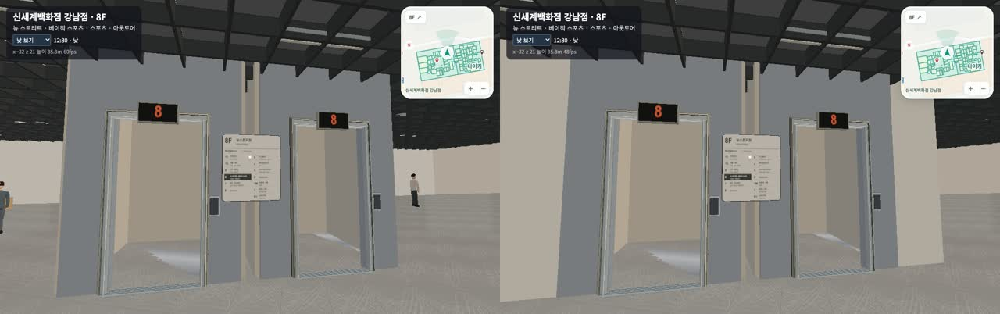

# 신세계 강남점 7·8층 본관 승강장

본관에서 화장실 옆 승강기 두 대는 기존 도면 기호에 맞게 서 있었지만, 게임에서는 양옆이 뚫려 카 뒤로 판매장이 보였다. 7층과 8층은 모두 승강기 기호를 지나는 벽 양끝이 꺾인다. 7층의 폴로 옆과 8층의 브라운브레스 옆은 굴곡 길이가 서로 다르다. 각 층의 벽선을 따라 기존 카까지 벽을 이었고, 문 앞에서 내리면 위치에 ‘본관 고객 엘리베이터’가 표시된다. 아래 화면은 같은 8층 시점의 수정 전(왼쪽)과 수정 후(오른쪽)다. [7층 공식 안내도](https://www.shinsegae.com/cms12/SC00002/guide/floor/__icsFiles/afieldfile/2026/11/17/GY5FSwwKSZxi.png) · [8층 공식 안내도](https://www.shinsegae.com/cms12/SC00002/guide/floor/__icsFiles/afieldfile/2026/08/25/q50Em0NqTGJa.png) · [같은 시점에서 보기](https://minwoo19930301.github.io/gangnam-terminal-world/#/shinsegae/8F?p=-32.37409,35.8,21.14732,-79.26665,4)

7층 신관의 승강기는 쌤소나이트 옆 외곽의 세로 벽에 붙어 있다. 11층 안내도에는 본관 화장실 옆 기호가 없다. 층별 지도는 한 카가 갈 수 있는 모든 층에 그 카의 좌표를 인쇄하면서 이미 다른 승강기가 있는 층에도 중복 표시했다. 도착층 선택은 유지하고, 지도에는 그 층에 구현된 카만 올린다. 7·8층에서 지도에 전달되는 승강기 기록이 각각 28개에서 9개로 줄었다. 화면에는 배율과 아이콘 사이의 여백에 따라 더 적게 표시된다. [11층 공식 안내도](https://www.shinsegae.com/cms12/SC00002/guide/floor/__icsFiles/afieldfile/2026/08/19/aelsFO7X4KMf.jpg)

게임 내 벽선은 2000 × 1500 안내도를 해당 층의 기존 평면에 맞춰 옮겼다. 벽 두께, 카 폭, 층 간 수직 정렬은 실측값이 아니다. 네이버 지도에서 강남점의 신반포로 176 주소와 지점 핀(동경 127.0042487°, 북위 37.5050011°)을 확인했다. 각 층의 벽선은 위 운영사 도면에서 판독했다. 정상 입력으로 8층에서 걸어가 E로 7층에 내린 뒤 같은 카를 다시 호출해 8층으로 돌아오는 검사는 `node tests/shinsegae-lift-landings.mjs`로 재현한다. [네이버 플레이스 지점 위치](https://map.naver.com/p/entry/place/12134145)
