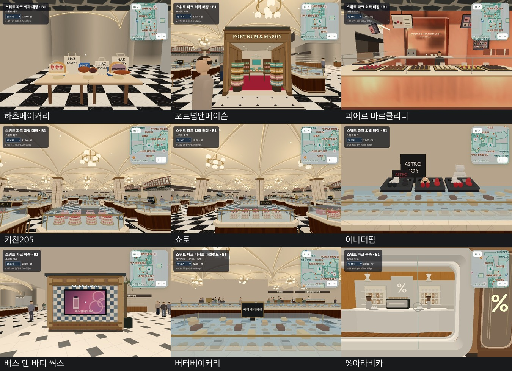

# 스위트 파크의 공개 통로와 진열대

신세계 강남점 11월 25일 B1 안내도에서 매장 영역과 흰색 고객 통로를 대조했다. 서쪽 벽면 네 매장은 동쪽 통로로 문을 내고, 독립 진열대 19곳은 가까운 통로에서 간판과 상품 앞면을 볼 수 있게 돌렸다. 태극당과 르빵 사이의 매장은 지도 표기와 11월의 강남점 채용 공고에서 버터베이커리로 확인했다. 북쪽의 준비 중인 매장에는 안내도대로 `OPENING SOON`을 표시한다. [신세계 강남점 B1 안내도](https://www.shinsegae.com/cms12/SC00002/guide/floor/__icsFiles/afieldfile/2026/11/25/GnV7UuBEdq7K.png) · [버터베이커리 강남점 공고](https://jobs.daangn.com/job-posts/신세계-강남점-주말-오픈-마감-베이커리-판매-모집-5pnho3sbjgre)

지도에서 검색할 수 있는 스위트 파크 매장·공동 매대 45곳을 방문했다. 뉴코아에서 첫 매장으로 이동한 다음 같은 B1에서 지도 검색과 ‘여기로 이동’을 반복했다. 45곳 모두 센트럴시티 B1의 통로에 도착했고 옆으로 0.97~1.06m 걸을 수 있었다. 아래 사진은 같은 게임에서 밤 10시 조명으로 촬영했다. 안내도의 매장 경계와 고객 통로가 배치의 기준이고, 진열 가구의 치수와 상품 수량은 공개 사진을 보고 맞췄다.

- 하츠베이커리의 샌드 베이글과 제품 포장을 Blender에서 모델링했다. [원본과 사진 출처](../../assets/models/haz-bakery/)
- 포트넘앤메이슨은 엘리베이터를 피해 고객 통로와 연결했다. 테두리가 들어간 목재 입구 사이로 들어가 양쪽 찻통과 뒤쪽 진열장을 볼 수 있다. [모델과 사진 출처](../../assets/models/fortnum-tea-shop/)
- 키친205의 딸기 케이크와 쇼토의 조각 케이크는 각각 다른 Blender 컬렉션으로 들어 있다. [두 매장의 모델과 자료](../../assets/models/sweet-cake-counters/)
- 메가박스는 상세 파일을 8초 이상 지연시켜도 광장에서 최초 화면에 상호와 세 개의 아치가 보인다. [입구 비교](../../assets/models/megabox-central/arrival-comparison.jpg)
