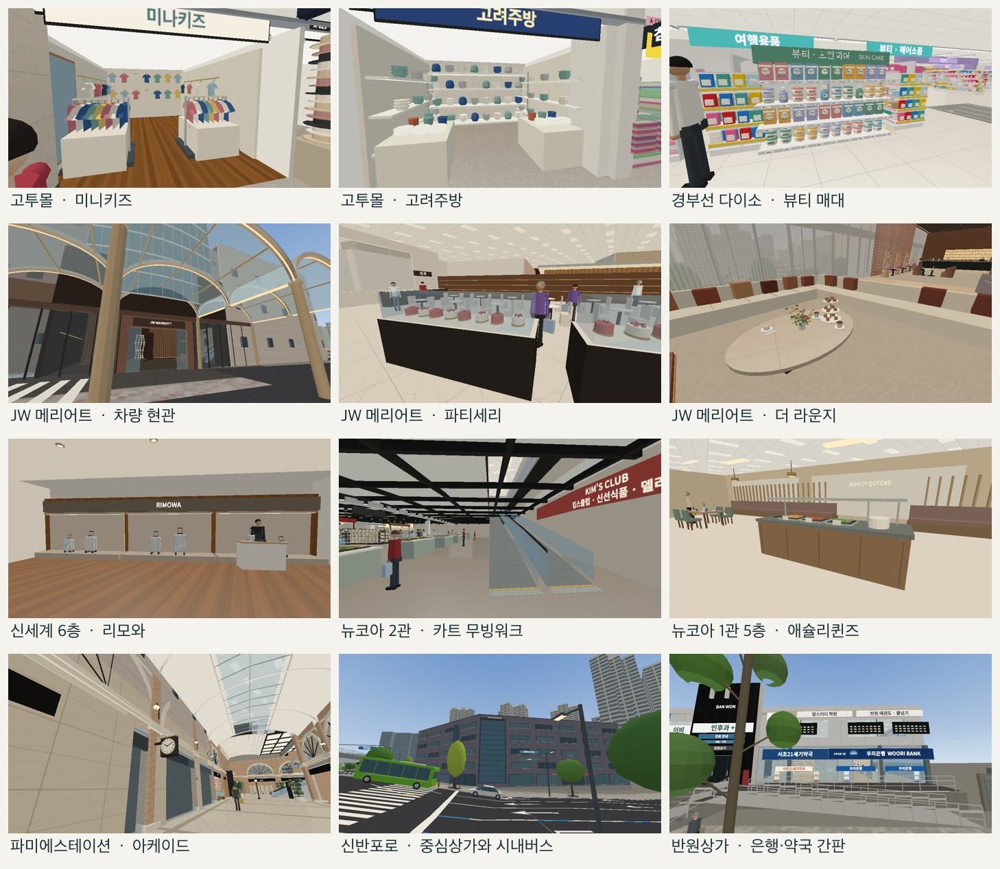

# 강남고속터미널 월드 재점검

2026년 11월 25일에 검토한 월드다. 아래 수량은 게임에 등록된 동선이다. 승강기 한 대가 지도와 층 선택을 위해 여러 번 등록된 경우도 있다.



## 모델과 근거

| 구역 | 반영한 내용 | 확인 범위 |
| --- | --- | --- |
| 고투몰 | 실제 상호 17곳에 의류·도자기·침구 등 집기 7종을 배치하고, 출입구에 표시된 승강 설비를 수정했다. | 서울시설공단 공용 배치도 3장, 운영사 점포 목록·사진, 네이버 지도. G7-1·G7-2의 게임 접속 위치는 미확정이다. [조사 기록](../../../data/research/gotomall.json) |
| 경부선 다이소 | B1 본점의 간판·상품 매대 6종·셀프계산대와 출구 앞 포장을 수정했다. | 같은 주소의 1F 2호점을 구별했다. 재고와 진열 간격은 대표 모형이다. [조사 기록](../../../data/research/gyeongbu.json) |
| JW 메리어트 | 차도 쪽 3연 아치 현관, 곡면 유리와 석재 띠, 2·7·8층 식음 공간을 보완했다. 4→3층 에스컬레이터와 백화점 통로의 벽 간섭을 해소했다. | 운영사 층 안내, 건축가 사진, 2026년 1월 네이버 거리뷰. 승강기 정차표·내부 평면의 정확한 치수는 현장 미확인이다. [조사 기록](../../../data/research/jwmarriott.json) |
| 신세계 6~11층 | 기존 상층 매장에 이어 6층 리모와의 벽장, 곡선 파이프 선반, 캐리어와 크로스백을 세분화했다. | 운영사 층별도와 리모와 지점 사진을 사용했다. 2~5층 신관의 회귀검사도 교정했다. [조사 기록](../../../data/research/shinsegae.json) |
| 뉴코아 | 1·2관 에스컬레이터 9쌍, 2관 카트 무빙워크 1쌍, 1관 5층 뷔페의 온장 배식대를 구성했다. | 운영사 층별도 12장이 연결 구역과 설비 종류를 뒷받침한다. 기기 치수와 진행 방향은 게임에 맞춘 추정이다. [조사 기록](../../../data/research/newcore.json) |
| 파미에스테이션 | 와필레 주문대·고객석 사이를 열고 양면 시계와 천창 프레임을 추가했다. | 운영사와 설계사 사진을 대조했다. [조사 기록](../../../data/research/famille.json) |
| 신반포로 주변 | 반원상가의 은행 심벌과 약국·학원 간판, 래미안퍼스티지 중심상가 5개 층의 창과 석재 외벽을 만들었다. | 2026년 1월 네이버 거리뷰에서 보이는 입면을 기준으로 했다. 중심상가의 모델 높이 19.5m는 사진 비례값이다. [반원상가](../../../data/research/banwon.json) · [중심상가](../../../assets/models/perstige/README.md) |
| 차량 | 승용차·택시·승합차·탑차·고속버스·시내버스·마을버스를 Blender 모델로 만들어 주행·주차 차량이 공유한다. | 차종별 대표 외형이다. 바퀴, 허브, 유리, 문, 등화, 버스 수하물함을 분리했다. [차량 모델](../../../assets/models/fleet/) |
| 거리·지형 | 연결 도로, 보행 신호, 전광판, 도로 거리와 지형은 앞선 지도 조사 결과를 통합했다. | 도로 중심선을 따른 거리, 지도 보행 경로, 현장 실측을 구분한다. [네트워크 조사](../network/README.md) |

## 게임 동선 검사

16개 장소 모듈과 지연 로딩 집기를 조립한 뒤, 일반 계단은 경사의 다섯 단면에서 바닥과 보행자 충돌을 확인했다. 중앙에 난간이 있을 수 있어 좌우도 검사했다. 에스컬레이터와 무빙워크는 세 지점에서 입력을 떼고 실제 게임 플레이어가 올바른 방향으로 움직이는지 검사했다. 서로 다른 높이에서 교차하는 바닥이나 진열대까지 물리에 포함했다.

| 대상 | 결과 |
| --- | --- |
| 일반 계단 | 429개 계단의 단면 검사 통과 |
| 계단식 에스컬레이터와 무빙워크 | 153개와 10개, 총 163개 자동 이동 검사 통과 |
| 엘리베이터 및 정차 지점 | 층 선택용 등록 152개, 정차 지점 386개. 전체 보행 검사에서 각 정차 지점의 출구를 검사한다. |
| 뉴코아 | 20개 방향 전 구간 자동 이동과 승하차, 중심선 표본 2,020개 통과 |
| 신세계 저층 | 공식 안내도의 대표 매장 13곳, 연결 경로 5개, 에스컬레이터 22개 통과 |

```sh
node --max-old-space-size=8192 tools/audit_vertical.mjs
node --max-old-space-size=12288 tests/walk.mjs
node tests/newcore-transfers.mjs
node tests/store-floor-regressions.mjs
node tests/fleet-regressions.mjs
```
